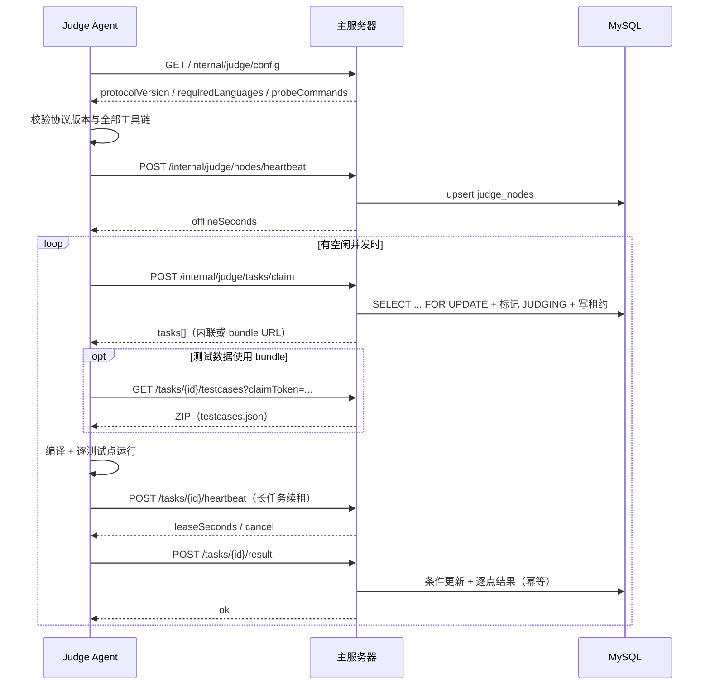

# 内部判题 API 索引

本文面向判题 Agent 与后端开发人员，说明主服务器与判题 Agent 之间的内部 HTTP 协议：启动配置、节点心跳、任务领取、租约续期、测试数据下载、结果回报和任务释放。它**不是**面向前端或公网用户的接口。

> 返回目录：[API 通用约定](../README.md) ｜ [文档总索引](../../README.md)

> **内部接口**：仅供内部调用方使用，不得暴露到公网或写进公开调用示例。生产部署应使用内网地址、VPN 或限制来源 IP；不要给公网 Nginx 增加 `/internal/judge/` 的转发。

## 1. 文档

| 文档 | 内容 |
| --- | --- |
| [内部判题 API](01-internal-api.md) | 认证、协议版本、7 个接口的请求/响应、数据模型、时序、错误与重试 |

判题状态机、Isolate 参数和语言配置的解释见 [判题设计](../../server/03-judge.md)；Agent 的部署与排障见 [判题 Agent 部署与运维](../../server/07-judge-agent.md)。

## 2. 与前端 API 的区别

| 项 | 前端 API | 内部判题 API |
| --- | --- | --- |
| 前缀 | `/api/v1` | `/internal/judge` |
| 凭据 | 用户 JWT | 管理员创建的 judge key |
| 角色 | `USER` / `ADMIN` | `JUDGE` |
| 响应 | `{ code, message, data }` | 同样是 `{ code, message, data }`，但 `data` 是内部 DTO |
| 暴露范围 | 可公网 | 仅判题网络 |
| 版本 | `/api/v1` | `ProtocolVersion.CURRENT`，当前 `2` |

两类凭据不能混用：用户 JWT 不能访问 `/internal/judge/**`，judge key 也不能访问 `/api/v1/**`。

## 3. 一次调用的生命周期

Agent 不连接 MySQL，也不持有用户 JWT；它只需要出站访问主服务器的内部 API。

## 4. 关键约定

- **认证**：`Authorization: Bearer <judge-key>`。key 只在创建时返回一次，数据库只存 SHA-256 哈希。
- **协议版本**：当前 `2`；v2 要求测试数据 bundle 必须是 ZIP，旧 JSON bundle 已移除。
- **任务租约**：claim 返回 `claimToken` 与 `leaseSeconds`；Agent 用心跳续租，过期后主服务器重新排队。
- **幂等**：同一 `claimToken` 重复回报结果返回成功但不重复写；旧 token 的迟到结果返回 `409`。
- **失败即停**：引擎在第一个失败测试点停止，`cases` 可能少于测试点总数。
- **内部错误**：与前端 API 使用同一套错误码；`409` 通常表示租约已失效/任务被重领。

## 5. 相关文档

- [内部判题 API](01-internal-api.md)
- [判题设计](../../server/03-judge.md)
- [判题 Agent 部署与运维](../../server/07-judge-agent.md)
- [API 通用约定](../README.md)
