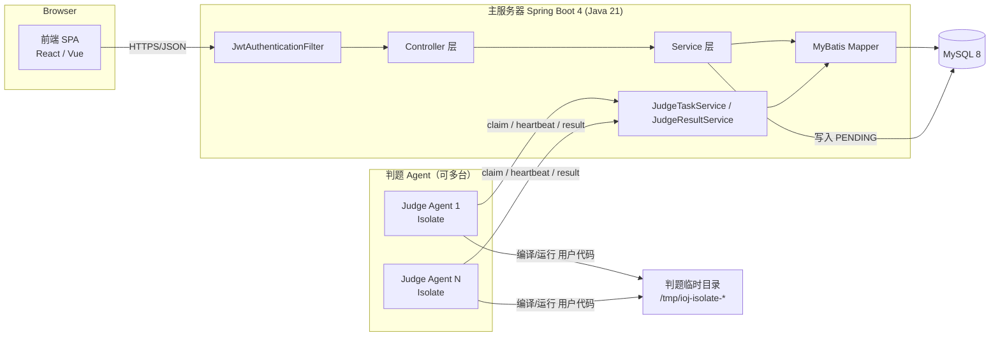
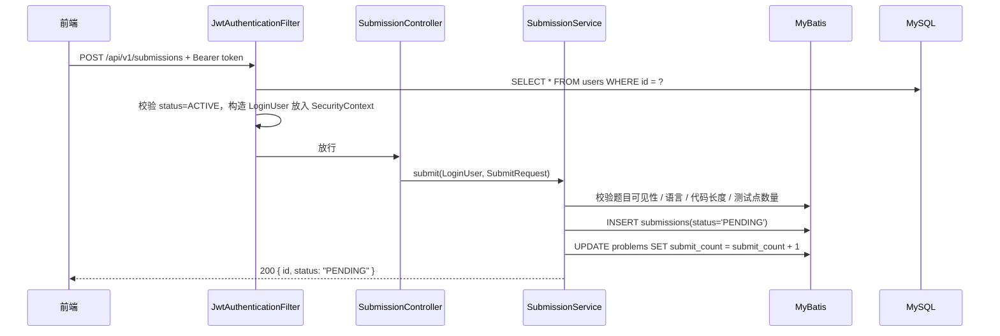
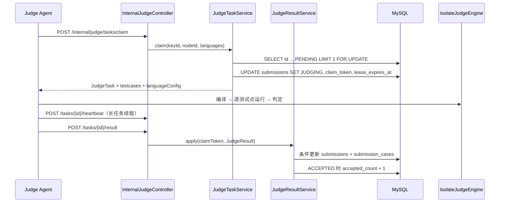

# 架构设计

本文说明 iOJ 的目标约束、模块边界、请求链路、分布式评测架构、权限模型和关键设计取舍，读者为后端开发与运维人员。阅读前建议先浏览 [后端总览](README.md)。

> 返回目录：[后端文档索引](README.md)

## 1. 目标与约束

- 用户自行上传题目，所有登录用户（甚至匿名访客）都能浏览、提交。
- 面向校内俱乐部：**几十到几百名用户、每天几百次提交**，不需要微服务/MQ/Redis。
- 主服务器负责 Web、数据库、任务调度；判题执行放在独立判题 Agent 上，可横向增加机器。
- 单人维护友好：一个主服务器 + 一个 MySQL + 若干判题 Agent，备份 = `mysqldump`。
- 判题必须隔离用户代码，且不得让一次死循环拖垮主服务器或判题机。

## 2. 总体架构



主服务器默认不再执行用户代码：

| 平面 | 运行位置 | 说明 |
| --- | --- | --- |
| Web | 主服务器 Tomcat 线程池 | 只做 CRUD，不允许在请求线程里判题 |
| 调度 | 主服务器 `@Scheduled` | claim、租约回收、节点离线检测 |
| Judge | 独立 Judge Agent 进程 | 编译、运行、比对，集中消耗 CPU/内存 |

两者通过数据库中的 `submissions.status` 和租约字段解耦：提交接口只写 `PENDING` 就返回。

> `ioj.judge.mode=local` 仍保留给测试和本地开发，生产环境使用默认的 `remote`。

## 3. 代码分层

```text
iOJ/
├── judge-protocol/  SubmissionStatus、Language、JudgeTask / JudgeResult 等内部协议 DTO
├── judge-core/      JudgeContext、JudgeOutcome、JudgeProperties、engine / sandbox / answer
├── judge-agent/     Agent 启动、claim 循环、心跳、结果回报
└── server/          主服务器：Web API、数据库、调度
    └── me.iynotuo.judge
        ├── common/        统一响应 ApiResponse、分页、ErrorCode、全局异常、业务枚举
        ├── config/        SecurityConfig、JwtProperties、线程池
        ├── security/      JwtTokenProvider、JwtAuthenticationFilter、JudgeKeyAuthenticationFilter、LoginUser
        ├── user/          entity / mapper / service / controller / dto / mail（邮箱验证码发信）
        ├── problem/       entity / mapper / service / controller / dto（含测试点、标签、scope、外部题库元数据与统一搜索）
        ├── submission/    提交记录
        └── judge/         JudgeTaskService、JudgeResultService、JudgeLeaseReaper、JudgeKeyService、JudgeNodeService
```

约定（详见 05-development.md）：

- Controller 只做参数绑定、权限注解和 VO 组装，不写业务分支。
- Service 持有事务边界（`@Transactional`），负责权限校验与领域规则。
- Mapper 只写 SQL；动态查询条件用 `Criteria` POJO 承载；列表行用 `*Row` POJO 接收 join 结果。
- 数据库实体（entity）与对外模型（dto/VO）分离，避免把 `password_hash`、测试数据、代码泄露给前端。

## 4. 请求链路（以"提交代码"为例）



关键点：

- **每次请求都查一次 users 表**（`JwtAuthenticationFilter`）。代价是一次主键查询，收益是封禁、改角色、改密/登出所有设备立即生效；旧 token 通过 `users.token_version` 比对失效，不需要额外黑名单表。
- JWT 中仍然带 `username`/`role` 便于日志排查，但**权限判定以数据库为准**。
- 请求线程永远不执行用户代码。

## 5. 判题流程（分布式异步）



- **租约抢占**：agent 领取任务时写入 `claim_token` 和 `lease_expires_at`，只有持有当前 token 的 agent 能续租或回报结果。
- **启动校验**：Agent 先拉取 `/internal/judge/config`，按 `probeCommands` 校验全部 `requiredLanguages`；缺任何语言就拒绝启动，不会先发心跳或 claim。
- **短事务**：领取和结果落库都是短事务；判题过程不持有数据库连接。
- **过期回收**：`JudgeLeaseReaper` 把过期租约重新变回 `PENDING`；超过最大尝试次数后判 `SYSTEM_ERROR`。
- **幂等**：同一 `claim_token` 的重复结果返回成功但不重复写；不同 token 的迟到结果返回 `409`。
- **fail-fast**：某个测试点失败后不再执行后续测试点，节省机器资源。
- **主服务器不执行用户代码**：`ioj.judge.mode=remote` 时不会创建本地判题 worker，也不会初始化 Isolate 引擎。

## 6. 权限模型

用户角色只有 `USER`、`ADMIN`，资源级权限在 Service 中判断。判题 Agent 不是用户角色，它使用独立的 judge key，在安全上下文中映射为 `ROLE_JUDGE`，只能访问 `/internal/judge/**`。

| 操作 | 匿名 | 登录用户 | 题目作者 | 管理员 |
| --- | --- | --- | --- | --- |
| 注册 / 登录 / 找回密码（邮箱验证码） | ✅ | ✅ | ✅ | ✅ |
| 浏览已发布题目 / 列表 / 题面样例 | ✅ | ✅ | ✅ | ✅ |
| 上传题目 | ❌ | ✅ | ✅ | ✅ |
| 编辑 / 删除题目 | ❌ | ❌ | ✅ | ✅ |
| 提交代码 | ❌ | ✅ | ✅ | ✅ |
| 查看提交记录（公开列表/详情，不含代码） | ✅ | ✅ | ✅ | ✅ |
| 查看隐藏测试点 | ❌ | ❌ | ✅ | ✅ |
| 查看未发布题目详情 | ❌ | ❌ | ✅ | ✅ |
| 查看他人提交的代码 | ❌ | ❌ | 自己题目的提交 | ✅ |
| 审核上下架 / 用户管理 | ❌ | ❌ | ❌ | ✅ |

实现位置：

- URL 级：`SecurityConfig`（公开接口白名单、`/api/v1/admin/**` 需要 ADMIN）。
- 方法级：`@PreAuthorize("hasRole('ADMIN')")` 在管理员 Controller 上。
- 资源级：`ProblemService#assertCanManage`、`SubmissionService#canSeePrivate`。

## 7. 安全设计

- 密码：BCrypt（strength 10），只存哈希；登录失败统一提示"用户名或密码错误"。
- JWT：HS256，密钥必须 ≥ 32 字节（启动时校验，太短直接启动失败）；默认 7 天过期；校验 `iss` 与签名。
- 隐藏数据：测试点内容、他人代码、编译信息都不出现在公共响应里（详见 [前端 API 文档](../api/frontend/README.md)）。
- 判题：在独立 Judge Agent 的 Isolate 沙箱内编译与运行（独立 box、cgroup 限制、CPU/墙钟/内存/文件大小/进程数）；主服务器不执行用户代码。详见 03-judge.md。
- 判题 Agent 认证：管理员创建的 API key；数据库只存 SHA-256 hash；`/internal/judge/**` 使用独立认证过滤器，不接触用户 JWT。
- 判题 Agent 网络：只需要出站访问主服务器内部 API，不需要公网入站端口，也不连接 MySQL。
- SQL：全部使用 MyBatis `#{}` 预编译参数，动态排序字段不来自用户输入，无拼接注入面。
- CORS：默认只放行 `http://localhost:5173`，通过 `IOJ_CORS_ORIGINS` 配置。
- 错误响应：不返回堆栈与 SQL，只返回 `code` + 可读消息。

## 8. 关键设计取舍

| 决策 | 原因 | 代价 / 何时改 |
| --- | --- | --- |
| 主服务器与判题 Agent 分离 | 判题峰值不抢 Web/数据库 CPU；判题机可横向扩展 | 多一个进程和内部网络；需要 key、租约和结果幂等 |
| 判题 Agent 主动拉取 | 判题机可以位于 NAT/内网，不需要入站端口 | 空闲时有轮询开销；当前用退避控制，量大再改长轮询 |
| 数据库当任务队列 | 少一个组件，天然持久化、可观测 | 吞吐上限低（每秒几十次抢占）；量大了换 MQ |
| 测试点存 MySQL | 备份/事务/权限最简单 | 单点上限受 `max_allowed_packet` 限制（默认 64 MB，足够）；超大测试集改对象存储 |
| 每次请求查用户表 | 封禁/提权立即生效 | 多一次主键查询；QPS 上千再考虑缓存 |
| 提交异步、前端轮询 | 无需 WebSocket | 前端每隔 500 ms~1 s 查一次详情即可 |
| 输出比对忽略行尾空格与文末空行 | 减少"格式错误"类无效 WA | 需要严格/自定义判定的题，作者上传 C++ 判题器（Special Judge，见 03-judge.md §10） |
