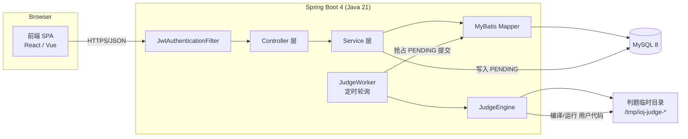
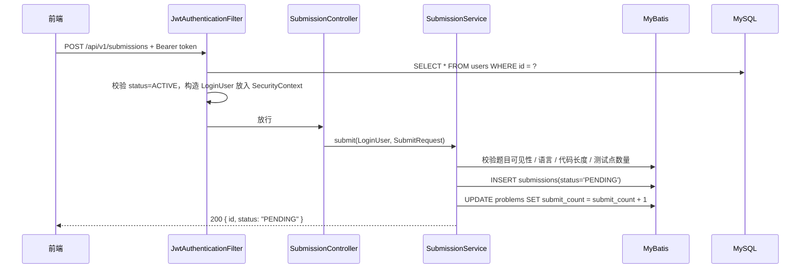
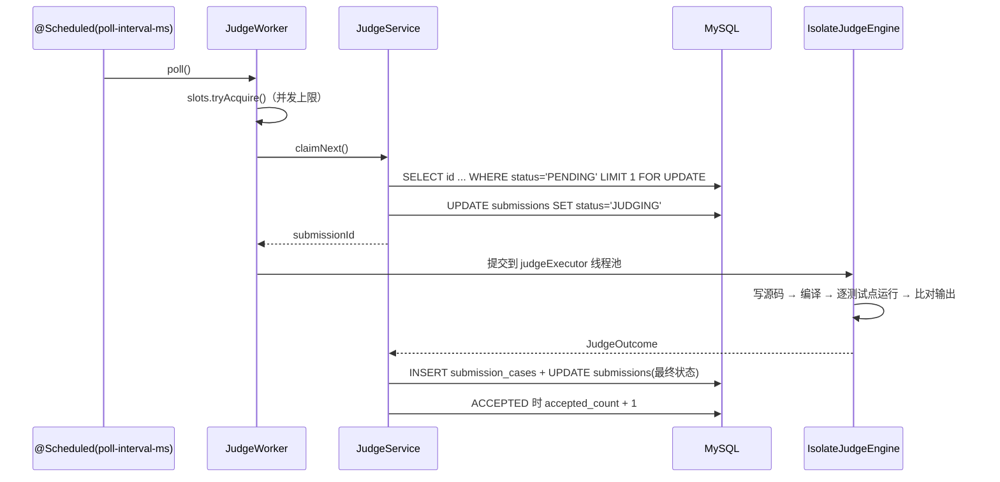

# 架构设计

## 1. 目标与约束

- 用户自行上传题目，所有登录用户（甚至匿名访客）都能浏览、提交。
- 面向校内俱乐部：**几十到几百名用户、每天几百次提交**，不需要微服务/MQ/Redis。
- 单人维护友好：一个 Spring Boot 进程 + 一个 MySQL 实例即可，备份 = `mysqldump`。
- 判题必须隔离用户代码，且不能让一次死循环拖垮整个服务。

## 2. 总体架构



进程内包含两个执行平面：

| 平面 | 线程 | 说明 |
| --- | --- | --- |
| Web | Tomcat 线程池 | 只做 CRUD，不允许在请求线程里判题 |
| Judge | `judgeExecutor`（默认 1 线程）+ `@Scheduled` 轮询线程 | 编译、运行、比对，慢操作集中在这里 |

两者通过数据库中的 `submissions.status` 解耦：提交接口只写 `PENDING` 就返回。

## 3. 代码分层

```
me.iynotuo.judge
├── common/        统一响应 ApiResponse、分页、ErrorCode、全局异常、业务枚举
├── config/        SecurityConfig、JwtProperties、JudgeProperties、线程池
├── security/      JwtTokenProvider、JwtAuthenticationFilter、LoginUser
├── user/          entity / mapper / service / controller / dto
├── problem/       entity / mapper / service / controller / dto（含测试点、标签）
├── submission/    提交记录
└── judge/         JudgeService、JudgeWorker、JudgeContext、JudgeOutcome、OutputComparator
    └── engine/    JudgeEngine（接口）、IsolateJudgeEngine（默认）、LocalProcessJudgeEngine（回退）、
                   StreamCollector、IsolateMeta
```

约定（详见 05-development.md）：

- Controller 只做参数绑定、权限注解和 VO 组装，不写业务分支。
- Service 持有事务边界（`@Transactional`），负责权限校验与领域规则。
- Mapper 只写 SQL；动态查询条件用 `Criteria` POJO 承载；列表行用 `*Row` POJO 接收 join 结果。
- 数据库实体（entity）与对外模型（dto/VO）分离，避免把 `password_hash`、测试数据、代码泄露给前端。

## 4. 请求链路（以"提交代码"为例）



关键点：

- **每次请求都查一次 users 表**（`JwtAuthenticationFilter`）。代价是一次主键查询，收益是封禁、改角色立即生效，不需要 token 黑名单。
- JWT 中仍然带 `username`/`role` 便于日志排查，但**权限判定以数据库为准**。
- 请求线程永远不执行用户代码。

## 5. 判题流程（异步）



- **短事务抢占**：`claimNext()` 在一个事务里锁住一行并改成 `JUDGING`，多实例部署时不会重复判题。
- **判题过程不持有数据库连接**：编译/运行耗时数百毫秒到数秒，事务早已提交。
- **失败兜底**：引擎抛异常 → `SYSTEM_ERROR`；进程重启 → 启动时把残留 `JUDGING` 重置为 `PENDING`（`JudgeService.recoverStuckSubmissions`）。
- **fail-fast**：某个测试点失败后不再执行后续测试点，节省机器资源。

## 6. 权限模型

角色只有两个：`USER`、`ADMIN`。资源级权限在 Service 中判断。

| 操作 | 匿名 | 登录用户 | 题目作者 | 管理员 |
| --- | --- | --- | --- | --- |
| 浏览已发布题目 / 列表 / 题面样例 | ✅ | ✅ | ✅ | ✅ |
| 上传题目 | ❌ | ✅ | ✅ | ✅ |
| 编辑 / 删除题目 | ❌ | ❌ | ✅ | ✅ |
| 提交代码 | ❌ | ✅ | ✅ | ✅ |
| 查看提交记录（公开列表/详情，不含代码） | ✅ | ✅ | ✅ | ✅ |
| 查看隐藏测试点 | ❌ | ❌ | ✅ | ✅ |
| 查看未发布题目详情 | ❌ | ❌ | ✅ | ✅ |
| 查看他人提交的代码 | ❌ | ❌ | 自己题目的提交 | ✅ |
| 审核上下架 / 用户管理 | ❌ | ❌ | ❌ | ✅ |

实现位置：

- URL 级：`SecurityConfig`（公开接口白名单、`/api/v1/admin/**` 需要 ADMIN）。
- 方法级：`@PreAuthorize("hasRole('ADMIN')")` 在管理员 Controller 上。
- 资源级：`ProblemService#assertCanManage`、`SubmissionService#canSeePrivate`。

## 7. 安全设计

- 密码：BCrypt（strength 10），只存哈希；登录失败统一提示"用户名或密码错误"。
- JWT：HS256，密钥必须 ≥ 32 字节（启动时校验，太短直接启动失败）；默认 7 天过期；校验 `iss` 与签名。
- 隐藏数据：测试点内容、他人代码、编译信息都不出现在公共响应里（详见 ../shared/api.md）。
- 判题：默认在 Isolate 沙箱内编译与运行（独立 box、cgroup 限制、CPU/墙钟/内存/文件大小/进程数）；也可回退到本机进程 + `ulimit`；详见 03-judge.md。
- SQL：全部使用 MyBatis `#{}` 预编译参数，动态排序字段不来自用户输入，无拼接注入面。
- CORS：默认只放行 `http://localhost:5173`，通过 `IOJ_CORS_ORIGINS` 配置。
- 错误响应：不返回堆栈与 SQL，只返回 `code` + 可读消息。

## 8. 关键设计取舍

| 决策 | 原因 | 代价 / 何时改 |
| --- | --- | --- |
| 单进程同时跑 Web + Judge | 部署、运维最省事 | 判题峰值会抢 CPU；可把 `IOJ_JUDGE_ENABLED=false` 后单独部署判题实例 |
| 数据库当任务队列 | 少一个组件，天然持久化、可观测 | 吞吐上限低（每秒几十次抢占）；量大了换 MQ |
| 测试点存 MySQL | 备份/事务/权限最简单 | 单点上限受 `max_allowed_packet` 限制（默认 64MB，足够）；超大测试集改对象存储 |
| 每次请求查用户表 | 封禁/提权立即生效 | 多一次主键查询；QPS 上千再考虑缓存 |
| 提交异步、前端轮询 | 无需 WebSocket | 前端每隔 500ms~1s 查一次详情即可 |
| 输出比对忽略行尾空格与文末空行 | 减少"格式错误"类无效 WA | 需要严格比对的题可换 special judge |
