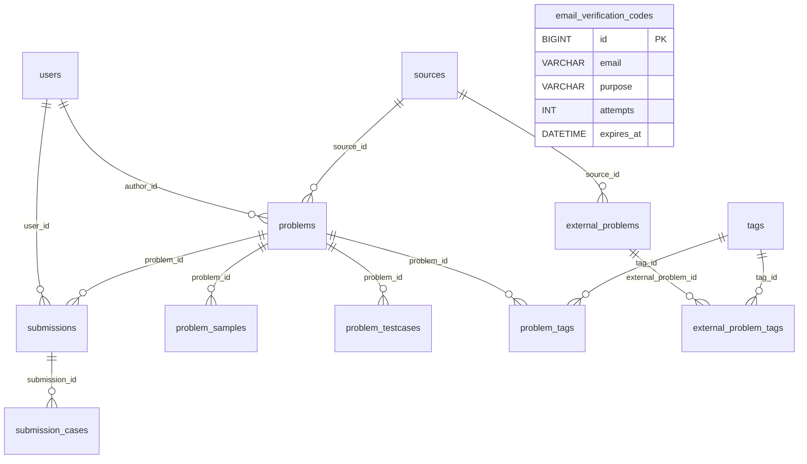

# 数据库设计

## 1. 文件与初始化

| 文件 | 用途 |
| --- | --- |
| `server/src/main/resources/db/schema.sql` | 建表脚本。使用可移植语法，MySQL 8 与 H2(MySQL 模式) 都能直接执行（测试就是这么跑的） |
| `server/src/main/resources/db/seed.sql` | 初始管理员（admin / admin123456）与常用标签 |

```bash
mysql -uroot -p -e "CREATE DATABASE ioj DEFAULT CHARACTER SET utf8mb4 COLLATE utf8mb4_general_ci;"
mysql -uioj -p ioj < server/src/main/resources/db/schema.sql
mysql -uioj -p ioj < server/src/main/resources/db/seed.sql
```

> `schema.sql` 里没有 `ENGINE/CHARSET` 子句，是为了让 H2 也能执行。生产库请在 `CREATE DATABASE` 时指定 `utf8mb4`。
>
> `seed.sql` 使用 `INSERT IGNORE`，可以重复执行；`schema.sql` 不是幂等的（重复执行会报 "Table already exists"）。
> 需要重建时先 `DROP DATABASE ioj;` 再重新 `CREATE DATABASE ioj ...`，然后依次执行两个脚本。

## 2. ER 图



## 3. 枚举取值（均为 VARCHAR，取值由 Java 枚举保证）

| 字段 | 取值 | 说明 |
| --- | --- | --- |
| `users.role` | `USER` / `ADMIN` | 普通用户 / 管理员 |
| `users.status` | `ACTIVE` / `BANNED` | 封禁后 JWT 仍有效但请求会被判为未登录 |
| `problems.difficulty` | `EASY` / `MEDIUM` / `HARD` | 难度筛选 |
| `problems.status` | `DRAFT` / `PENDING_REVIEW` / `PUBLISHED` / `HIDDEN` | 草稿 / 待审核 / 已发布 / 已下架 |
| `submissions.language` | `JAVA` / `CPP` / `C` / `PYTHON3` | 与 `ioj.judge.languages` 的 key 一致 |
| `submissions.status` | `PENDING` / `JUDGING` / `ACCEPTED` / `WRONG_ANSWER` / `TIME_LIMIT_EXCEEDED` / `MEMORY_LIMIT_EXCEEDED` / `OUTPUT_LIMIT_EXCEEDED` / `RUNTIME_ERROR` / `COMPILATION_ERROR` / `CHECKER_ERROR` / `SYSTEM_ERROR` | 提交总状态 |
| `submission_cases.status` | 同上（不含 `PENDING`/`JUDGING`） | 单测试点状态 |
| `email_verification_codes.purpose` | `REGISTER` / `RESET_PASSWORD` | 发码用途：注册 / 找回密码。**码与用途绑定**，注册码不能用于重置，反之亦然 |

枚举都用字符串而不是 TINYINT：可读性高、排查问题时不用查字典、加值时不用改表。代价是多占几个字节，俱乐部规模完全无感。

> 例外：`problems.rating` 是**数值**列（`INT`，0-5000，可空），用于“按难度分筛选/排序”。它和 `difficulty` 并列存放、互不推导：`difficulty` 给只认档位的老页面用，`rating` 给需要细粒度筛选的新页面用。两者可能不一致（例如 `difficulty='EASY'` 而 `rating=2200`），这是当前有意接受的取舍。

## 4. 表结构

### 4.1 users —— 用户

| 字段 | 类型 | 约束 | 说明 |
| --- | --- | --- | --- |
| id | BIGINT | PK, AUTO_INCREMENT | |
| username | VARCHAR(32) | NOT NULL, UNIQUE | 登录名，3-32 位字母数字下划线 |
| email | VARCHAR(128) | NOT NULL, UNIQUE | 可用于登录 |
| password_hash | VARCHAR(100) | NOT NULL | BCrypt，**任何接口都不返回** |
| nickname | VARCHAR(32) | NOT NULL | 展示名 |
| role | VARCHAR(16) | NOT NULL DEFAULT 'USER' | `USER` / `ADMIN` |
| status | VARCHAR(16) | NOT NULL DEFAULT 'ACTIVE' | `ACTIVE` / `BANNED` |
| created_at | DATETIME | NOT NULL | |
| updated_at | DATETIME | NOT NULL | |
| last_login_at | DATETIME | NULL | 登录时更新 |

索引：`uk_users_username`、`uk_users_email`（唯一索引同时承担"注册去重"和"并发注册兜底"）。

### 4.2 sources —— 题目来源

由管理员维护，出题/改题时只能从已有来源中选择（客户端传 `sourceId`）。

| 字段 | 类型 | 约束 | 说明 |
| --- | --- | --- | --- |
| id | BIGINT | PK, AUTO_INCREMENT | |
| name | VARCHAR(128) | NOT NULL, UNIQUE | 来源名，如“2026 新生赛”“洛谷”；唯一键大小写不敏感 |
| created_at | DATETIME | NOT NULL | 创建时间 |

`problems.source_id` 与 `external_problems.source_id` 都是指向本表的外键（`ON DELETE` 无级联，删除在用来源会被数据库拒绝），因此来源改名对两类题目自动生效，也不会出现拼写不一致的“野生来源”。

### 4.3 problems —— 题目

| 字段 | 类型 | 约束 | 说明 |
| --- | --- | --- | --- |
| id | BIGINT | PK | |
| title | VARCHAR(128) | NOT NULL | 标题 |
| difficulty | VARCHAR(16) | NOT NULL DEFAULT 'EASY' | 难度档位（`EASY`/`MEDIUM`/`HARD`），与 `rating` 相互独立 |
| rating | INT | NULL | 数值难度分（0-5000），用于列表筛选/排序；未评分为 `NULL`（接口统一返回 `0`），服务端**不会**由 `difficulty` 推算 |
| description | MEDIUMTEXT | NOT NULL | 题面（纯文本/Markdown） |
| input_format | MEDIUMTEXT | NULL | 输入格式说明 |
| output_format | MEDIUMTEXT | NULL | 输出格式说明 |
| hint | MEDIUMTEXT | NULL | 提示 |
| source_id | BIGINT | FK → sources.id | 题目来源；`NULL` 表示未记录来源。只能引用管理员维护的来源（见 4.2） |
| checker_code | MEDIUMTEXT | NULL | 自定义判题器（Special Judge）源码，C++（兼容 C 风格）；`NULL` 或空白表示用内置的 `OutputComparator` 逐行比对 |
| time_limit_ms | INT | NOT NULL DEFAULT 1000 | 时间限制（毫秒，基准值） |
| memory_limit_mb | INT | NOT NULL DEFAULT 256 | 内存限制 |
| author_id | BIGINT | FK → users.id | 上传者 |
| status | VARCHAR(16) | NOT NULL DEFAULT 'PENDING_REVIEW' | 见枚举表 |
| submit_count | INT | NOT NULL DEFAULT 0 | 提交次数（冗余计数） |
| accepted_count | INT | NOT NULL DEFAULT 0 | 通过次数（冗余计数） |
| created_at / updated_at | DATETIME | NOT NULL | |

`checker_code` 的几条约定：

- 判题器是**出题者上传的 C++ 源码**，判题时在沙箱里用 `g++` 编译后逐测试点运行（见 `03-judge.md` §10）。
- 判题器的时限与内存**不在数据库里**，而是配置项 `ioj.judge.checker.*`。原因是判题器需要的内存通常比选手程序大一个量级，而"某道题需要更久的判题器"这种需求在俱乐部规模下可以直接整体调大。
- 该列**不会**出现在 `ProblemMapper.findById` 的查询里：公开的 `GET /problems/{id}` 与判题取数是两条不同的查询，避免判题逻辑通过公开接口泄漏。列表接口同样不返回，详情接口只返回 `hasChecker` 布尔值。
- 修改判题器走独立端点 `PUT /problems/{id}/checker`，**不并入** `PUT /problems/{id}`：后者是整体替换，客户端漏传一次就会静默退回内置比对。

`submit_count` / `accepted_count` 是冗余字段：列表页要展示通过率，如果每次都 `COUNT(submissions)` 会拖慢列表。写入时机：提交时 `+1`，判题通过时 `accepted_count + 1`（定义为"通过提交数"，与主流 OJ 一致）。

### 4.4 problem_samples —— 题面展示样例

| 字段 | 类型 | 约束 | 说明 |
| --- | --- | --- | --- |
| id | BIGINT | PK | |
| problem_id | BIGINT | FK → problems.id, `ON DELETE CASCADE` | |
| ordinal | INT | NOT NULL | 展示顺序，从 1 开始 |
| input_data | MEDIUMTEXT | NOT NULL | |
| output_data | MEDIUMTEXT | NOT NULL | |
| explanation | MEDIUMTEXT | NULL | 样例解释 |

唯一键 `uk_samples_problem_ordinal (problem_id, ordinal)`。**样例是公开的**，与判题数据分开存放，避免"样例即测试点"导致的泄漏。

### 4.5 problem_testcases —— 隐藏测试点

| 字段 | 类型 | 约束 | 说明 |
| --- | --- | --- | --- |
| id | BIGINT | PK | |
| problem_id | BIGINT | FK → problems.id, `ON DELETE CASCADE` | |
| ordinal | INT | NOT NULL | 测试点编号，从 1 开始 |
| input_data | MEDIUMTEXT | NOT NULL | 标准输入 |
| output_data | MEDIUMTEXT | NOT NULL | 标准输出 |
| created_at | DATETIME | NOT NULL | |

唯一键 `uk_testcases_problem_ordinal (problem_id, ordinal)`。

存储策略说明：

- 数据直接放 MySQL，**备份/恢复/权限控制/事务一致性**都最简单，一个人维护不容易出错。
- 单条测试点的上限由 `ioj.problem.max-testcase-bytes`（默认 4 MiB，按 UTF-8 字节、`input` 与 `output` 各自计算）控制，可随时用 `IOJ_PROBLEM_MAX_TESTCASE_BYTES` 覆盖；整批写入还受 MySQL `max_allowed_packet` 约束（批量 PUT 会拼成一条 INSERT）。校内题目一般几十 KB，完全够用。
- 如果将来要放几百 MB 的测试集，把 `input_data/output_data` 换成对象存储路径，只需改 `ProblemTestcaseMapper` 与判题取数逻辑，接口无需变化。
- 只有题目作者与管理员能读取内容，列表接口只返回 `inputBytes/outputBytes`。

### 4.6 tags / problem_tags —— 标签

`tags`：`id BIGINT PK`、`name VARCHAR(32) NOT NULL UNIQUE`。

`problem_tags`：联合主键 `(problem_id, tag_id)`，两个外键均 `ON DELETE CASCADE`，额外索引 `idx_problem_tags_tag (tag_id)` 支持"按标签找题"。

上传/编辑题目时 `tagIds` 传**已存在**的标签 id（≤10 个）：服务端先按 id 批量校验，全部存在才写关联表；不存在返回 `400/1001`，**不会**自动创建标签。标签字典只由管理员通过 `POST/PUT/DELETE /admin/tags` 维护。

### 4.7 submissions —— 提交记录

| 字段 | 类型 | 约束 | 说明 |
| --- | --- | --- | --- |
| id | BIGINT | PK | |
| problem_id | BIGINT | FK → problems.id, CASCADE | |
| user_id | BIGINT | FK → users.id, CASCADE | |
| language | VARCHAR(16) | NOT NULL | `JAVA`/`CPP`/`C`/`PYTHON3` |
| code | MEDIUMTEXT | NOT NULL | 源代码（≤ 64KB，服务层校验） |
| status | VARCHAR(24) | NOT NULL DEFAULT 'PENDING' | 判题状态 |
| time_used_ms | INT | NULL | 已执行测试点的最大耗时 |
| memory_used_kb | INT | NULL | 内存峰值（Isolate 引擎写入 `cg-mem`；本机进程回退模式下为 null，见 03-judge.md） |
| compile_message | MEDIUMTEXT | NULL | 编译错误输出 |
| judge_message | TEXT | NULL | 系统错误信息，含判题器编译失败时的编译器输出；不含测试数据 |
| created_at | DATETIME | NOT NULL | 提交时间 |
| judged_at | DATETIME | NULL | 判题完成时间 |

### 4.8 submission_cases —— 逐测试点结果

| 字段 | 类型 | 约束 | 说明 |
| --- | --- | --- | --- |
| id | BIGINT | PK | |
| submission_id | BIGINT | FK → submissions.id, CASCADE | |
| case_ordinal | INT | NOT NULL | 对应 `problem_testcases.ordinal` |
| status | VARCHAR(24) | NOT NULL | 单点状态 |
| time_used_ms | INT | NULL | |
| memory_used_kb | INT | NULL | |
| message | VARCHAR(1024) | NULL | 运行错误信息等，**不记录期望输出** |

唯一键 `uk_submission_cases_ordinal (submission_id, case_ordinal)`，重判时先删后插，天然幂等。

### 4.9 external_problems —— 外部 OJ 题目（仅元数据）

只存“指路牌”：题名、来源、难度分、链接，以及原站的提交/通过次数。**不存题面、不存测试数据、不参与本机判题**，所以 `submit_count` / `accepted_count` 由导入或管理员维护，
本站不会因为有人提交而加 1。

| 字段 | 类型 | 约束 | 说明 |
| --- | --- | --- | --- |
| id | BIGINT | PK, AUTO_INCREMENT | |
| source_id | BIGINT | NOT NULL, FK → sources.id | 来源（OJ 平台或比赛），**与本地题共用同一张来源表**；来源名由 `LEFT JOIN sources` 取得 |
| code | VARCHAR(32) | NULL, UNIQUE | 原站题目的短标识，如 `CF_2278G`、`AT_ABC482_G`；用于导入去重和排查，无法推导题号时可为 `NULL` |
| title | VARCHAR(200) | NOT NULL | 题目名称（`LIKE` 搜索） |
| rating | INT | NULL | 该平台的难度分（刻度随来源不同，跨平台不可比）；为 `NULL` 时接口返回 `0` |
| difficulty | VARCHAR(16) | NOT NULL DEFAULT 'UNKNOWN' | 由 rating 推导的档位：Codeforces `<1400` / `1400–1999` / `≥2000`，AtCoder `<800` / `800–1599` / `≥1600`；rating 为空归为 `UNKNOWN` |
| time | DATETIME | NULL | clist 返回的 `time`，已从 UTC 转换为中国时区（UTC+8）；通常是题目所属比赛开始时间，AtCoder 镜像题可能是训练赛时间。通过 `GET /catalog` 的 `time` 返回，本地题为 `null` |
| submit_count | INT | NOT NULL DEFAULT 0 | 提交次数（**来自原站/人工导入，本站不累加**） |
| accepted_count | INT | NOT NULL DEFAULT 0 | 通过次数（同上，仅用于展示与通过率） |
| url | VARCHAR(512) | NOT NULL, UNIQUE | 原题链接；唯一键同时承担“防重复导入” |
| created_at / updated_at | DATETIME | NOT NULL | |

`code` 由 `scripts/sync_clist_problems.py` 从 clist 的 `url` / `short` 推导后写入，规则见脚本文件头注释。它既是导入查重标识，也会通过 `GET /catalog` 返回给前端（本地题为 `null`）；外部题的定位仍以 `id` + `url` 为准。两个唯一键分工如下：

- `uk_external_problems_url`：同一链接不能重复导入；
- `uk_external_problems_code`：同一原站题号（如 `CF_2278G`）不能重复；`NULL` 不参与唯一性冲突，无法推导题号的行可以留空。

### 4.10 external_problem_tags —— 外部题目标签

| 字段 | 类型 | 约束 | 说明 |
| --- | --- | --- | --- |
| external_problem_id | BIGINT | FK → external_problems.id, CASCADE | |
| tag_id | BIGINT | FK → tags.id, CASCADE | 与本地题目共用 `tags` |

联合主键 `(external_problem_id, tag_id)`，额外索引 `idx_external_problem_tags_tag (tag_id)`。

> 为什么标签要两张关联表（`problem_tags` + `external_problem_tags`）而不是一张多态表：多态表（`target_type` + `target_id`）无法建外键，删题/删标签都要应用层清理，容易留悬挂引用；两张关联表虽然多一个 mapper，但级联、改名校验、索引都是数据库替你保证的。
>
> 标签“使用次数”要同时统计两张表：
> ```sql
> SELECT
>   (SELECT COUNT(*) FROM problem_tags          WHERE tag_id = ?)
> + (SELECT COUNT(*) FROM external_problem_tags WHERE tag_id = ?) AS usage;
> ```

标签同步来源：Codeforces 使用官方 `problemset.problems` API 的 `tags` 字段，脚本会同步写入 `tags` 并重建对应外部题的 `external_problem_tags` 关联。clist 的 problem 对象本身没有主题标签；AtCoder 没有主题标签来源，正常同步不会修改它已有的标签关联。

### 4.11 email_verification_codes —— 邮箱验证码

| 字段 | 类型 | 约束 | 说明 |
| --- | --- | --- | --- |
| id | BIGINT | PK, AUTO_INCREMENT | 自增值同时充当“发出顺序” |
| email | VARCHAR(128) | NOT NULL | 已 `trim` + 小写化的地址；MySQL 大小写不敏感、H2 敏感，归一化保证两边行为一致 |
| purpose | VARCHAR(16) | NOT NULL DEFAULT `'REGISTER'` | 发码用途，见 §3 枚举 |
| code | VARCHAR(16) | NOT NULL | 6 位数字明文。有效期短且一次性使用，六位数字做哈希等于没哈希，所以不存摘要 |
| attempts | INT | NOT NULL DEFAULT 0 | 已输错次数；达到 `ioj.email-code.max-attempts` 即作废该行 |
| expires_at | DATETIME | NOT NULL | 过期时间 = 发码时间 + `ioj.email-code.ttl-minutes`；作废时直接置为当前时间 |
| consumed_at | DATETIME | NULL | 非空表示已成功使用，不可重放 |
| created_at | DATETIME | NOT NULL | 发码时间，同时用于冷却与每小时上限的统计 |

要点：

- **不做外键**：验证码发生在建号之前，`users` 里还没有对应行。
- 每次发码插一行而不是覆盖：历史行本身就是限流台账。
  - 冷却：`ORDER BY id DESC LIMIT 1` 取最新一行的 `created_at`。
  - 每小时上限：`COUNT(*)` 最近一小时的行数。
- “作废”复用 `expires_at`（置为当前时间），不额外加 `invalidated_at` 列；查询只认 `expires_at > now` 的行。
- 清理：`@Scheduled` 每小时删除 `expires_at < now - cleanup-retention-hours` 的行，保留最近一天便于排查误报。该 DELETE 幂等，多实例重复执行无害。

## 5. 索引设计与关键 SQL

| 索引 | 服务的查询 |
| --- | --- |
| `idx_problems_status_id (status, id)` | 题库列表：`WHERE status='PUBLISHED' ORDER BY id DESC` |
| `idx_problems_status_rating (status, rating)` | 题库列表按难度分筛选：`WHERE status='PUBLISHED' AND rating BETWEEN ? AND ?` |
| `idx_problems_author (author_id, id)` | "我上传的题目" |
| `idx_problems_source (source_id, id)` | 按来源找题、以及删除来源前的占用检查 |
| `idx_problems_difficulty (difficulty)` | 难度筛选 |
| `idx_problem_tags_tag (tag_id)` | 按标签筛选（`EXISTS` 子查询） |
| `idx_external_problems_source_rating (source_id, rating)` | 外部题按来源 + 难度筛选 |
| `idx_external_problems_rating (rating, id)` | 外部题按难度区间筛选 |
| `idx_external_problems_difficulty (difficulty)` | 外部题按 `EASY` / `MEDIUM` / `HARD` / `UNKNOWN` 筛选 |
| `idx_external_problems_time (time)` | 外部题按比赛/题目时间排序或筛选 |
| `uk_external_problems_url (url)` | 外部题按链接去重 |
| `uk_external_problems_code (code)` | 外部题按原站题号去重（`NULL` 不冲突） |
| `idx_external_problem_tags_tag (tag_id)` | 外部题按标签筛选 |
| `idx_submissions_problem (problem_id, id)` | 题目下的提交列表 |
| `idx_submissions_user (user_id, id)` | 用户的提交记录 |
| `idx_submissions_status (status, id)` | 判题 worker 抢占 `WHERE status='PENDING' ORDER BY id LIMIT 1` |
| `idx_email_verification_codes_email (email, purpose, id)` | 取该邮箱最新的验证码、统计最近一小时发码数 |
| `idx_email_verification_codes_expires (expires_at)` | 定时清理过期行 |

判题抢占 SQL（MySQL 8）：

```sql
START TRANSACTION;
SELECT id FROM submissions WHERE status = 'PENDING' ORDER BY id LIMIT 1 FOR UPDATE;
UPDATE submissions SET status = 'JUDGING' WHERE id = ?;
COMMIT;
```

对俱乐部规模来说，串行抢占（不加 `SKIP LOCKED`）足够；如果以后要多判题机并行，把 SQL 改成 `FOR UPDATE SKIP LOCKED` 即可（MySQL 8 支持，H2 不支持，注意测试库差异）。

## 6. 事务与一致性

- 创建/更新题目：`problems` + `problem_samples` + `problem_tags` 在同一个事务内完成。
- 提交：插入 `submissions` 与 `problems.submit_count + 1` 同一事务；这里允许计数多 1（提交成功但事务回滚的概率极低），计数仅用于展示。
- 判题落库：删除旧 `submission_cases` → 插入新结果 → 更新 `submissions` → 通过时 `accepted_count + 1`，同一事务。
- 删除题目：外键 `ON DELETE CASCADE` 自动清理样例、测试点、标签关联与提交记录，避免留下孤儿数据。
- 注册时验证码与建号的关系：`verify` 只读校验，`users` 插入与 `markConsumed` 在**同一个事务**里，所以插库失败时验证码仍可用、成功时不可能被重放；而“输错次数 +1”走 `REQUIRES_NEW`（`EmailCodeAttemptRecorder`），否则它会随注册事务的回滚一起丢失，尝试次数上限就永远触发不了。

## 7. 容量估算（俱乐部规模）

| 表 | 估算行数 | 单行大小 | 总量 |
| --- | --- | --- | --- |
| users | 200 | < 1KB | < 1MB |
| problems | 500 | 题面 5~50KB | 5~25MB |
| problem_testcases | 5000（每题 10 个） | 1~20KB | 10~100MB |
| submissions | 50000 | 代码 1~5KB | 50~250MB |
| submission_cases | 500000 | < 200B | < 100MB |
| email_verification_codes | 每天几十行，保留 24 小时 | < 200B | 可忽略 |

总计 < 500MB，单机 MySQL 轻松承载。日常备份 `mysqldump --single-transaction` 即可（见 04-deployment.md）。

## 8. 后续扩展建议

| 需求 | 建议改动 |
| --- | --- |
| 比赛/榜单 | 新增 `contests`、`contest_problems`、`contest_registrations`；榜单用 `submissions` 聚合，或单独建 `contest_rank_cache` |
| 题解/评论 | `problem_solutions`、`problem_comments`，加 `visibility` 与审核字段 |
| 收藏/点赞 | `problem_favorites(user_id, problem_id)` 联合主键 |
| 测试数据上对象存储 | `problem_testcases` 增加 `input_key/output_key`，`input_data/output_data` 置空 |
| 提交状态审计 | 增加 `submission_events(submission_id, from_status, to_status, created_at)` |

