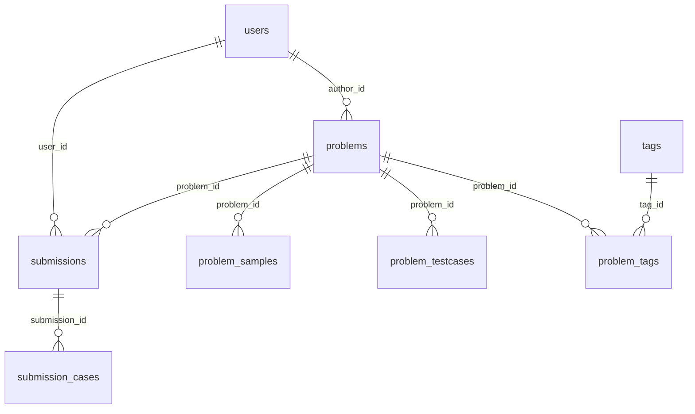

# 数据库设计

## 1. 文件与初始化

| 文件 | 用途 |
| --- | --- |
| `server/src/main/resources/db/schema.sql` | 建表脚本。使用可移植语法，MySQL 8 与 H2(MySQL 模式) 都能直接执行（测试就是这么跑的） |
| `server/src/main/resources/db/seed.sql` | 初始管理员（admin / admin123456）与常用标签 |

```bash
mysql -uroot -p -e "CREATE DATABASE ioj DEFAULT CHARACTER SET utf8mb4 COLLATE utf8mb4_general_ci;"
mysql -uioj -p ioj < server/src/main/resources/db/schema.sql
mysql -uioj -p ioj < server/src/main/resources/db/seed.sql
```

> `schema.sql` 里没有 `ENGINE/CHARSET` 子句，是为了让 H2 也能执行。生产库请在 `CREATE DATABASE` 时指定 `utf8mb4`。
>
> `seed.sql` 使用 `INSERT IGNORE`，可以重复执行；`schema.sql` 不是幂等的（重复执行会报 "Table already exists"）。
> 需要重建时先 `DROP DATABASE ioj;` 再重新 `CREATE DATABASE ioj ...`，然后依次执行两个脚本。

## 2. ER 图



## 3. 枚举取值（均为 VARCHAR，取值由 Java 枚举保证）

| 字段 | 取值 | 说明 |
| --- | --- | --- |
| `users.role` | `USER` / `ADMIN` | 普通用户 / 管理员 |
| `users.status` | `ACTIVE` / `BANNED` | 封禁后 JWT 仍有效但请求会被判为未登录 |
| `problems.difficulty` | `EASY` / `MEDIUM` / `HARD` | 难度筛选 |
| `problems.status` | `DRAFT` / `PENDING_REVIEW` / `PUBLISHED` / `HIDDEN` | 草稿 / 待审核 / 已发布 / 已下架 |
| `submissions.language` | `JAVA` / `CPP` / `C` / `PYTHON3` | 与 `ioj.judge.languages` 的 key 一致 |
| `submissions.status` | `PENDING` / `JUDGING` / `ACCEPTED` / `WRONG_ANSWER` / `TIME_LIMIT_EXCEEDED` / `MEMORY_LIMIT_EXCEEDED` / `OUTPUT_LIMIT_EXCEEDED` / `RUNTIME_ERROR` / `COMPILATION_ERROR` / `CHECKER_ERROR` / `SYSTEM_ERROR` | 提交总状态 |
| `submission_cases.status` | 同上（不含 `PENDING`/`JUDGING`） | 单测试点状态 |

枚举都用字符串而不是 TINYINT：可读性高、排查问题时不用查字典、加值时不用改表。代价是多占几个字节，俱乐部规模完全无感。

## 4. 表结构

### 4.1 users —— 用户

| 字段 | 类型 | 约束 | 说明 |
| --- | --- | --- | --- |
| id | BIGINT | PK, AUTO_INCREMENT | |
| username | VARCHAR(32) | NOT NULL, UNIQUE | 登录名，3-32 位字母数字下划线 |
| email | VARCHAR(128) | NOT NULL, UNIQUE | 可用于登录 |
| password_hash | VARCHAR(100) | NOT NULL | BCrypt，**任何接口都不返回** |
| nickname | VARCHAR(32) | NOT NULL | 展示名 |
| role | VARCHAR(16) | NOT NULL DEFAULT 'USER' | `USER` / `ADMIN` |
| status | VARCHAR(16) | NOT NULL DEFAULT 'ACTIVE' | `ACTIVE` / `BANNED` |
| created_at | DATETIME | NOT NULL | |
| updated_at | DATETIME | NOT NULL | |
| last_login_at | DATETIME | NULL | 登录时更新 |

索引：`uk_users_username`、`uk_users_email`（唯一索引同时承担"注册去重"和"并发注册兜底"）。

### 4.2 problems —— 题目

| 字段 | 类型 | 约束 | 说明 |
| --- | --- | --- | --- |
| id | BIGINT | PK | |
| title | VARCHAR(128) | NOT NULL | 标题 |
| difficulty | VARCHAR(16) | NOT NULL DEFAULT 'EASY' | 难度 |
| description | MEDIUMTEXT | NOT NULL | 题面（纯文本/Markdown） |
| input_format | MEDIUMTEXT | NULL | 输入格式说明 |
| output_format | MEDIUMTEXT | NULL | 输出格式说明 |
| hint | MEDIUMTEXT | NULL | 提示 |
| source | VARCHAR(128) | NULL | 题目来源 |
| checker_code | MEDIUMTEXT | NULL | 自定义判题器（Special Judge）源码，C++（兼容 C 风格）；`NULL` 或空白表示用内置的 `OutputComparator` 逐行比对 |
| time_limit_ms | INT | NOT NULL DEFAULT 1000 | 时间限制（毫秒，基准值） |
| memory_limit_mb | INT | NOT NULL DEFAULT 256 | 内存限制 |
| author_id | BIGINT | FK → users.id | 上传者 |
| status | VARCHAR(16) | NOT NULL DEFAULT 'PENDING_REVIEW' | 见枚举表 |
| submit_count | INT | NOT NULL DEFAULT 0 | 提交次数（冗余计数） |
| accepted_count | INT | NOT NULL DEFAULT 0 | 通过次数（冗余计数） |
| created_at / updated_at | DATETIME | NOT NULL | |

`checker_code` 的几条约定：

- 判题器是**出题者上传的 C++ 源码**，判题时在沙箱里用 `g++` 编译后逐测试点运行（见 `03-judge.md` §10）。
- 判题器的时限与内存**不在数据库里**，而是配置项 `ioj.judge.checker.*`。原因是判题器需要的内存通常比选手程序大一个量级，而"某道题需要更久的判题器"这种需求在俱乐部规模下可以直接整体调大。
- 该列**不会**出现在 `ProblemMapper.findById` 的查询里：公开的 `GET /problems/{id}` 与判题取数是两条不同的查询，避免判题逻辑通过公开接口泄漏。列表接口同样不返回，详情接口只返回 `hasChecker` 布尔值。
- 修改判题器走独立端点 `PUT /problems/{id}/checker`，**不并入** `PUT /problems/{id}`：后者是整体替换，客户端漏传一次就会静默退回内置比对。

`submit_count` / `accepted_count` 是冗余字段：列表页要展示通过率，如果每次都 `COUNT(submissions)` 会拖慢列表。写入时机：提交时 `+1`，判题通过时 `accepted_count + 1`（定义为"通过提交数"，与主流 OJ 一致）。

### 4.3 problem_samples —— 题面展示样例

| 字段 | 类型 | 约束 | 说明 |
| --- | --- | --- | --- |
| id | BIGINT | PK | |
| problem_id | BIGINT | FK → problems.id, `ON DELETE CASCADE` | |
| ordinal | INT | NOT NULL | 展示顺序，从 1 开始 |
| input_data | MEDIUMTEXT | NOT NULL | |
| output_data | MEDIUMTEXT | NOT NULL | |
| explanation | MEDIUMTEXT | NULL | 样例解释 |

唯一键 `uk_samples_problem_ordinal (problem_id, ordinal)`。**样例是公开的**，与判题数据分开存放，避免"样例即测试点"导致的泄漏。

### 4.4 problem_testcases —— 隐藏测试点

| 字段 | 类型 | 约束 | 说明 |
| --- | --- | --- | --- |
| id | BIGINT | PK | |
| problem_id | BIGINT | FK → problems.id, `ON DELETE CASCADE` | |
| ordinal | INT | NOT NULL | 测试点编号，从 1 开始 |
| input_data | MEDIUMTEXT | NOT NULL | 标准输入 |
| output_data | MEDIUMTEXT | NOT NULL | 标准输出 |
| created_at | DATETIME | NOT NULL | |

唯一键 `uk_testcases_problem_ordinal (problem_id, ordinal)`。

存储策略说明：

- 数据直接放 MySQL，**备份/恢复/权限控制/事务一致性**都最简单，一个人维护不容易出错。
- 单点上限由 `ioj.problem.max-testcase-bytes`（默认 1MB）与 MySQL `max_allowed_packet` 共同约束。校内题目一般几十 KB，完全够用。
- 如果将来要放几百 MB 的测试集，把 `input_data/output_data` 换成对象存储路径，只需改 `ProblemTestcaseMapper` 与判题取数逻辑，接口无需变化。
- 只有题目作者与管理员能读取内容，列表接口只返回 `inputBytes/outputBytes`。

### 4.5 tags / problem_tags —— 标签

`tags`：`id BIGINT PK`、`name VARCHAR(32) NOT NULL UNIQUE`。

`problem_tags`：联合主键 `(problem_id, tag_id)`，两个外键均 `ON DELETE CASCADE`，额外索引 `idx_problem_tags_tag (tag_id)` 支持"按标签找题"。

上传题目时 `tags` 传名称数组，不存在的标签会自动创建（`ProblemService#getOrCreateTag`，并发冲突时重新查询兜底）。

### 4.6 submissions —— 提交记录

| 字段 | 类型 | 约束 | 说明 |
| --- | --- | --- | --- |
| id | BIGINT | PK | |
| problem_id | BIGINT | FK → problems.id, CASCADE | |
| user_id | BIGINT | FK → users.id, CASCADE | |
| language | VARCHAR(16) | NOT NULL | `JAVA`/`CPP`/`C`/`PYTHON3` |
| code | MEDIUMTEXT | NOT NULL | 源代码（≤ 64KB，服务层校验） |
| status | VARCHAR(24) | NOT NULL DEFAULT 'PENDING' | 判题状态 |
| time_used_ms | INT | NULL | 已执行测试点的最大耗时 |
| memory_used_kb | INT | NULL | 内存峰值（Isolate 引擎写入 `cg-mem`；本机进程回退模式下为 null，见 03-judge.md） |
| compile_message | MEDIUMTEXT | NULL | 编译错误输出 |
| judge_message | TEXT | NULL | 系统错误信息，含判题器编译失败时的编译器输出；不含测试数据 |
| created_at | DATETIME | NOT NULL | 提交时间 |
| judged_at | DATETIME | NULL | 判题完成时间 |

### 4.7 submission_cases —— 逐测试点结果

| 字段 | 类型 | 约束 | 说明 |
| --- | --- | --- | --- |
| id | BIGINT | PK | |
| submission_id | BIGINT | FK → submissions.id, CASCADE | |
| case_ordinal | INT | NOT NULL | 对应 `problem_testcases.ordinal` |
| status | VARCHAR(24) | NOT NULL | 单点状态 |
| time_used_ms | INT | NULL | |
| memory_used_kb | INT | NULL | |
| message | VARCHAR(1024) | NULL | 运行错误信息等，**不记录期望输出** |

唯一键 `uk_submission_cases_ordinal (submission_id, case_ordinal)`，重判时先删后插，天然幂等。

## 5. 索引设计与关键 SQL

| 索引 | 服务的查询 |
| --- | --- |
| `idx_problems_status_id (status, id)` | 题库列表：`WHERE status='PUBLISHED' ORDER BY id DESC` |
| `idx_problems_author (author_id, id)` | "我上传的题目" |
| `idx_problems_difficulty (difficulty)` | 难度筛选 |
| `idx_problem_tags_tag (tag_id)` | 按标签筛选（`EXISTS` 子查询） |
| `idx_submissions_problem (problem_id, id)` | 题目下的提交列表 |
| `idx_submissions_user (user_id, id)` | 用户的提交记录 |
| `idx_submissions_status (status, id)` | 判题 worker 抢占 `WHERE status='PENDING' ORDER BY id LIMIT 1` |

判题抢占 SQL（MySQL 8）：

```sql
START TRANSACTION;
SELECT id FROM submissions WHERE status = 'PENDING' ORDER BY id LIMIT 1 FOR UPDATE;
UPDATE submissions SET status = 'JUDGING' WHERE id = ?;
COMMIT;
```

对俱乐部规模来说，串行抢占（不加 `SKIP LOCKED`）足够；如果以后要多判题机并行，把 SQL 改成 `FOR UPDATE SKIP LOCKED` 即可（MySQL 8 支持，H2 不支持，注意测试库差异）。

## 6. 事务与一致性

- 创建/更新题目：`problems` + `problem_samples` + `problem_tags` 在同一个事务内完成。
- 提交：插入 `submissions` 与 `problems.submit_count + 1` 同一事务；这里允许计数多 1（提交成功但事务回滚的概率极低），计数仅用于展示。
- 判题落库：删除旧 `submission_cases` → 插入新结果 → 更新 `submissions` → 通过时 `accepted_count + 1`，同一事务。
- 删除题目：外键 `ON DELETE CASCADE` 自动清理样例、测试点、标签关联与提交记录，避免留下孤儿数据。

## 7. 容量估算（俱乐部规模）

| 表 | 估算行数 | 单行大小 | 总量 |
| --- | --- | --- | --- |
| users | 200 | < 1KB | < 1MB |
| problems | 500 | 题面 5~50KB | 5~25MB |
| problem_testcases | 5000（每题 10 个） | 1~20KB | 10~100MB |
| submissions | 50000 | 代码 1~5KB | 50~250MB |
| submission_cases | 500000 | < 200B | < 100MB |

总计 < 500MB，单机 MySQL 轻松承载。日常备份 `mysqldump --single-transaction` 即可（见 04-deployment.md）。

## 8. 后续扩展建议

| 需求 | 建议改动 |
| --- | --- |
| 比赛/榜单 | 新增 `contests`、`contest_problems`、`contest_registrations`；榜单用 `submissions` 聚合，或单独建 `contest_rank_cache` |
| 题解/评论 | `problem_solutions`、`problem_comments`，加 `visibility` 与审核字段 |
| 收藏/点赞 | `problem_favorites(user_id, problem_id)` 联合主键 |
| 测试数据上对象存储 | `problem_testcases` 增加 `input_key/output_key`，`input_data/output_data` 置空 |
| 提交状态审计 | 增加 `submission_events(submission_id, from_status, to_status, created_at)` |

