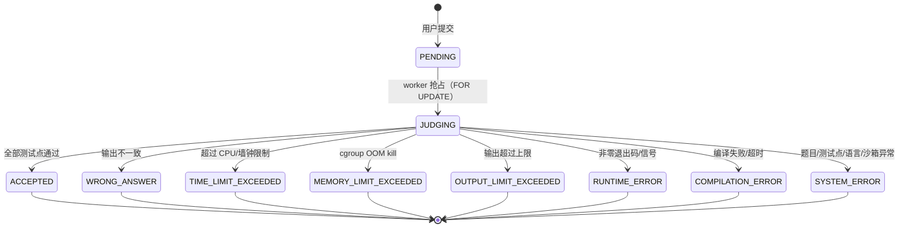

# 判题设计

## 1. 状态机



- 使用 `engine=isolate` 时，内存超限由 cgroup OOM 事件可靠判定；`engine=local` 回退模式一般只表现为运行时错误。
- 所有终态都会写入 `judged_at`；`SYSTEM_ERROR` 同时写 `judge_message`。
- 判题采用 fail-fast：某个测试点失败后不再执行后续测试点。

## 2. 判题引擎选择

`JudgeEngine` 是接口（`me.iynotuo.judge.judge.engine.JudgeEngine`），实现类通过 Spring 的条件装配选择：

| `ioj.judge.engine` | 实现类 | 说明 |
| --- | --- | --- |
| `isolate`（默认） | `IsolateJudgeEngine` | 编译与运行都在 Isolate 沙箱内，资源限制与统计最完整 |
| `local` | `LocalProcessJudgeEngine` | 本机进程 + `ulimit`，用于没有 Isolate 的开发机或测试环境 |
| `docker` | 未实现 | 预留，需要自行实现 `JudgeEngine` |

- 选择方式：`application.yaml` 的 `ioj.judge.engine`，或环境变量 `IOJ_JUDGE_ENGINE`。
- 选择机制是 `@ConditionalOnProperty`（不是运行时工厂）：值不匹配任何实现时，应用启动会失败（`JudgeService` 缺少 `JudgeEngine` Bean），这是有意的 fail-fast。
- 与 `ioj.judge.enabled` 正交：后者只控制 worker 是否消费待评测任务。
- 测试环境使用 `local`（`src/test/resources/application-test.yaml`），生产使用 `isolate`。

## 3. 一次判题做了什么（isolate）

```
JudgeService.judge(submissionId)
├── 读取 submission / problem / problem_testcases / 语言配置
├── IsolateJudgeEngine.judge(context)
│   ├── 从 box-id 池取一个编号，创建临时工作目录
│   ├── 编译阶段
│   │   ├── isolate --init（新 box）
│   │   ├── 把工作目录挂到 /box，写入源码
│   │   ├── isolate --run -- javac/g++ ...（受限 CPU/墙钟/内存/进程数）
│   │   ├── 读取 meta 与编译输出；失败 → COMPILATION_ERROR
│   │   └── isolate --cleanup
│   ├── 每个测试点
│   │   ├── isolate --init（干净 box）
│   │   ├── 复制编译产物与 input.txt 到新的工作目录
│   │   ├── isolate --run -- java/g++ 程序（题限 × 语言系数）
│   │   ├── 解析 meta：status / time / cg-mem / exitcode / cg-oom-killed
│   │   ├── 输出比对 → WA / AC；失败即停止
│   │   └── isolate --cleanup
│   └── 汇总取最大耗时/内存，返回 JudgeOutcome
└── persist：重写 submission_cases + 更新 submissions + accepted_count
```

要点：

- **编译也在沙箱内**，不把宿主机当作可信环境。
- 每个测试点使用**独立 box 与独立工作目录**，前一个测试点无法留下文件或修改程序。
- 工作目录通过 `--dir=/box=<host_dir>:rw` 绑定，worker 不需要写 Isolate 的 box 根目录。
- 外层还有 `Process.waitFor` 看门狗，Isolate 自身挂起时会被强制结束。

## 4. 语言配置

配置位于 `application.yaml` 的 `ioj.judge.languages`，key 是提交时的 `language` 枚举名。
占位符在运行时替换：

| 占位符 | 含义 |
| --- | --- |
| `{memoryMb}` / `{memoryKb}` | 题目的内存限制（MB / KB） |
| `{timeMs}` | 本题实际时间限制（已乘语言系数） |
| `{command}` | 仅用于 `runWrapper`（isolate 引擎不使用），会被展开后的 `runCommand` 替换 |

默认四种语言（isolate 引擎）：

| Language | 源码文件 | 编译命令 | 运行命令 | 时间系数 | 进程数 | 额外内存 |
| --- | --- | --- | --- | --- | --- | --- |
| JAVA | Main.java | `javac -encoding UTF-8 -d . Main.java` | `java -Xmx{memoryMb}m -Xss64m -XX:+UseSerialGC Main` | 2.0 | 64 | +256MB |
| CPP | main.cpp | `g++ -O2 -std=c++17 -pipe -o main main.cpp` | `./main` | 1.0 | 1 | +16MB |
| C | main.c | `gcc -O2 -std=c11 -pipe -o main main.c` | `./main` | 1.0 | 1 | +16MB |
| PYTHON3 | main.py | 无 | `python3 main.py` | 3.0 | 1 | +64MB |

- **时间系数**：抵消 JVM/Python 启动的固定开销，只作用于运行阶段。
- **进程数**：Isolate 的 `--processes` 统计的是任务/线程数。JVM 需要大量线程，因此 Java 设为 64；C/C++/Python 用 1。
- **额外内存**：JVM 需要 metaspace、code cache、线程栈等，`--cg-mem` 在题目限制上另加 256MB；C++/Python 留少量余量。
- 命令的第一个词会解析成**宿主机真实路径**（例如 `javac` → `/usr/lib/jvm/.../bin/javac`），避免沙箱内跟随 `/etc/alternatives` 符号链接失败。
- Python 这类解释型语言没有编译产物，运行阶段会把源文件复制到运行目录。

新增语言仍是两步：`common/enums/Language.java` 加枚举值，`application.yaml` 补一段配置；然后确认裁判机安装了对应工具链。

## 5. Isolate 沙箱

### 5.1 前置条件

| 项 | 要求 |
| --- | --- |
| 服务 | `systemctl status isolate.service` 为 active（cgroup 委派） |
| cgroup | cgroup v2（`stat -fc %T /sys/fs/cgroup` 输出 `cgroup2fs`），内存统计需要 Linux 5.19+ |
| 权限 | 运行后端的用户能执行 `/usr/bin/isolate`（通常在 `isolate` 组，`sudo usermod -aG isolate <user>` 后重新登录） |
| box id | 同一台机器上唯一；不要与 root 手工测试留下的 box 冲突（本项目默认从 1 开始） |
| 额外目录 | Debian JDK 需要只读绑定 `/etc/java-21-openjdk`（`java.security`） |

命令与安装步骤见 [06-isolate.md](06-isolate.md)。

### 5.2 配置项

| 配置 | 默认 | 说明 |
| --- | --- | --- |
| `ioj.judge.isolate.binary` | `/usr/bin/isolate` | 可执行文件路径 |
| `ioj.judge.isolate.box-id-start` / `box-id-count` | `1` / `8` | 本实例可用的 box 编号区间；应不小于并发数 |
| `ioj.judge.isolate.check-on-startup` | `true` | 启动时检查 binary 可执行，失败直接终止 |
| `ioj.judge.isolate.compile-processes` | `64` | 编译阶段进程/线程上限（javac 需要较多） |
| `ioj.judge.isolate.compile-time-seconds` / `compile-wall-time-seconds` | `10` / `30` | 编译 CPU / 墙钟上限 |
| `ioj.judge.isolate.compile-cg-mem-kb` | `524288` | 编译内存上限（512MB） |
| `ioj.judge.isolate.compile-fsize-kb` | `16384` | 编译阶段文件大小上限（16MB） |
| `ioj.judge.isolate.wall-time-extra-seconds` | `3` | 运行阶段墙钟 = CPU 限制 + 该值 |
| `ioj.judge.isolate.extra-dirs` | `/etc/java-21-openjdk` | 只读绑定进沙箱的宿主机目录 |
| `ioj.judge.isolate.resolve-executables` | `true` | 把命令第一个词解析成真实路径 |
| `ioj.judge.isolate.setup-timeout-ms` | `10000` | init/cleanup 的超时 |

每次运行传给 Isolate 的限制：

| Isolate 参数 | 来源 |
| --- | --- |
| `--time` | `题限 × 语言系数`（秒，CPU） |
| `--wall-time` | 上式向上取整 + `wall-time-extra-seconds` |
| `--cg-mem` | `(题目内存 + 语言额外内存) × 1024` KB |
| `--fsize` | `max-output-bytes / 1024 + 64` KB |
| `--processes` | 语言的 `isolate-processes` |
| `--dir` | 工作目录挂到 `/box`（rw），`extra-dirs` 原路径只读 |
| `--chdir` | `/box` |
| `--stdin` / `--stdout` / `--stderr` | `/box/input.txt`、`/box/output.txt`、`/box/stderr.txt` |
| `--meta` | 沙箱外的临时文件 |
| `--env` | `PATH=/usr/bin:/bin`、`TMPDIR=/box`、`LANG=C.UTF-8` |

### 5.3 meta → 判题状态

| meta / 进程信息 | 判题结果 |
| --- | --- |
| `status=TO` | `TIME_LIMIT_EXCEEDED` |
| `cg-oom-killed` 存在 | `MEMORY_LIMIT_EXCEEDED` |
| 输出文件达到 `max-output-bytes` | `OUTPUT_LIMIT_EXCEEDED` |
| `status=SG` / `status=RE` / `exitcode≠0` | `RUNTIME_ERROR` |
| `status=XX` 或外层看门狗超时 | `SYSTEM_ERROR` |
| 输出一致 | `ACCEPTED` |

`time`（CPU 秒）与 `cg-mem`（KB）会写入 `submissions` 与 `submission_cases`，所以使用 isolate 后 `memoryUsedKb` 不再是 `null`。

## 6. 本机进程回退（`engine=local`）

用于没有 Isolate 的开发机、CI 或单元测试（测试 profile 固定使用该引擎）。它把用户程序作为普通子进程运行：

| 手段 | 实现 |
| --- | --- |
| 超时 | `Process.waitFor(timeLimit)`，超时 `destroyForcibly` |
| 内存 | C/C++/Python 使用 `ulimit -v`，Java 使用 `-Xmx`；**无法精确统计峰值** |
| 输出 | 读取线程限流，超出上限停止保存 |
| 文件 | `ulimit -f`（C/C++） |

限制：无法阻止 fork bomb、网络访问、提权；内存超限通常表现为运行时错误而不是 MLE。因此**仅适合校内/可信用户**，生产环境应使用 isolate。

## 7. 并发与调参

| 配置 | 作用 | 建议 |
| --- | --- | --- |
| `ioj.judge.concurrency` | 同时评测的提交数（worker 线程数） | CPU 核数 - 1 |
| `ioj.judge.isolate.box-id-count` | 本实例可用 box 数 | ≥ 并发数；多实例部署时用 `box-id-start` 分段 |
| `ioj.judge.isolate.compile-processes` | 编译阶段进程/线程上限 | 保持 64，javac 需要较多线程 |
| 语言的 `isolate-processes` | 运行阶段线程上限 | Java 64；C/C++/Python 1 |
| 语言的 `isolate-memory-extra-mb` | 运行时额外内存 | Java 256；其余按需 |

注意：

- 同一台机器上 box id 不能冲突。两个判题实例要么共用一段 id（由不同进程竞争会出错），要么用不同的 `box-id-start` 区间。
- 逐任务的 Isolate 限制不能替代整机容量管理：给系统、数据库和 worker 留出余量。
- 编译器与运行库版本应固定，避免不同节点产生差异。

## 8. 常见问题

| 现象 | 原因 | 处理 |
| --- | --- | --- |
| 启动报 `isolate binary is not executable` | 运行用户没有执行权限 | `sudo usermod -aG isolate <user>` 后重新登录；确认 `isolate --version` 可用 |
| `isolate --init` 报 `This box belongs to a different user` | 该 box 编号被其他用户（常见是 root）创建过 | 换 `box-id-start`（默认已从 1 开始），或让原用户执行 `isolate --box-id=N --cleanup` |
| 编译报 `execve("javac"): No such file or directory` | `/usr/bin/javac` 指向 `/etc/alternatives`，沙箱未挂载该目录 | 保持 `resolve-executables: true`（默认），或改用绝对路径 |
| JVM 启动报 `Error loading java.security file` | 沙箱内缺少 `/etc/java-21-openjdk` | 在 `extra-dirs` 中保留该目录（Debian），或按发行版调整 |
| `pthread_create failed (EAGAIN)` | `--processes` 太小，JVM 无法创建线程 | 提高 Java 的 `isolate-processes`（默认 64）或 `compile-processes` |
| 内存超限没有判成 MLE | 使用了 `engine=local` | 切换到 isolate；isolate 通过 cgroup OOM 检测 |
| 提交一直 `PENDING` | worker 被关闭或队列积压 | 检查 `IOJ_JUDGE_ENABLED`、`GET /submissions?status=PENDING`、服务日志 |
| 编译超时（`COMPILATION_ERROR: Compile Time Exceeded`） | `compile-time-seconds` / `compile-wall-time-seconds` 太小 | 提高配置，注意编译与运行限制分开设置 |
| `/var/lib/isolate` 残留目录 | 进程被强杀，未执行 cleanup | 确认服务日志；用对应用户执行 `isolate --cg --box-id=N --cleanup` |

## 9. 可观测性

- 判题完成日志：`判题完成 submissionId=... status=...`。
- 沙箱清理失败会打印 `isolate --cleanup failed for box ...`，需要关注是否有残留 box。
- 建议采集：待判队列长度、各状态占比、判题耗时 P95、`cg-mem` 分布、Isolate 内部错误（`status=XX`）次数。
- 首次上线前用已知程序验证：正常 AC、死循环（TLE）、越界（RE）、超量输出（OLE）、内存压力（MLE），确认分类符合预期。


