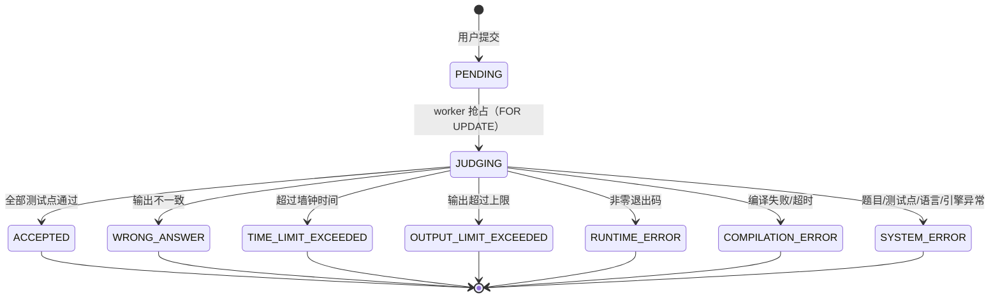

# 判题设计

## 1. 状态机



- `MEMORY_LIMIT_EXCEEDED` 已在枚举中预留，本地引擎无法可靠判定，留给 Docker 引擎（用 cgroup OOM 事件）。
- 所有终态都会被写入 `judged_at`；`SYSTEM_ERROR` 同时写 `judge_message`。

## 2. 一次判题做了什么

```
JudgeService.judge(submissionId)
├── 读取 submission / problem / problem_testcases / 语言配置
├── LocalProcessJudgeEngine.judge(context)
│   ├── mkdtemp：/tmp/ioj-judge-xxxx
│   ├── 写入源码（Main.java / main.cpp / main.c / main.py）
│   ├── 编译（有 compileCommand 时）
│   │   └── 超时 → COMPILATION_ERROR；退出码 ≠ 0 → COMPILATION_ERROR
│   └── 逐个测试点：
│       ├── 把 input_data 写入 stdin.txt
│       ├── bash -c "<runWrapper>"（内嵌 ulimit）→ 运行
│       ├── 墙钟超时 → TLE；输出超限 → OLE；退出码 ≠ 0 → RE
│       ├── 比对 stdout 与 output_data → WA / AC
│       └── 失败即 break（fail-fast）
└── persist：重写 submission_cases + 更新 submissions + accepted_count
```

## 3. 语言配置

配置位于 `application.yaml` 的 `ioj.judge.languages`，key 是提交时的 `language` 枚举名。
三个占位符会在运行时替换：

| 占位符 | 含义 |
| --- | --- |
| `{memoryMb}` / `{memoryKb}` | 题目的内存限制（MB / KB） |
| `{timeMs}` | 本题实际时间限制（已乘语言系数） |
| `{command}` | 仅用于 `runWrapper`，会被展开后的 `runCommand` 替换 |

默认四种语言：

| Language | 源码文件 | 编译命令 | 运行包装 | 时间系数 |
| --- | --- | --- | --- | --- |
| JAVA | Main.java | `javac -encoding UTF-8 -d . Main.java` | `exec {command}`（JVM 由 `-Xmx{memoryMb}m` 限堆） | 2.0 |
| CPP | main.cpp | `g++ -O2 -std=c++17 -pipe -o main main.cpp` | `ulimit -v {memoryKb}; ulimit -s 65536; exec {command}` | 1.0 |
| C | main.c | `gcc -O2 -std=c11 -pipe -o main main.c` | 同上 | 1.0 |
| PYTHON3 | main.py | 无 | `ulimit -v {memoryKb}; exec {command}` | 3.0 |

时间系数存在的原因：JVM/Python 启动有固定开销（几十到上百毫秒），如果题目限时 1000ms，Java 程序可能"没写任何逻辑"就 TLE。系数只对运行阶段生效。

新增语言只需两步：在 `common/enums/Language.java` 加枚举值（决定数据库取值与前端选项），在 `application.yaml` 加一段配置。代码无需改动。

## 4. 资源限制与沙箱

### 4.1 本地引擎（默认，`ioj.judge.engine=local`）

| 风险 | 处理 |
| --- | --- |
| 无限输出撑爆磁盘/内存 | stdout 上限 `ioj.judge.max-output-bytes`（16MB），读取线程达到上限后继续消费但不再保存；stderr 只留 8KB |
| 死循环 | 墙钟超时（`题限 × 语言系数`），超时 `destroyForcibly` |
| 内存爆炸 | C/C++/Python 用 `ulimit -v`；Java 用 `-Xmx`；**无法精确统计峰值**，故 `memoryUsedKb` 通常为 null |
| 文件写满磁盘 | `ulimit -f 65536`（64MB，cpp/c） |
| 临时文件残留 | `finally` 中递归删除 `/tmp/ioj-judge-*` |
| fork bomb / 网络访问 / 提权 | **本地引擎无法阻止**，必须换容器方案 |
| 编译期跑代码 | 编译命令只执行编译器；源码是文件，不执行 |

### 4.2 生产加固（重要）

如果站点只对校内成员开放（注册需要审核/邀请码），本地引擎可以接受；**一旦对公网开放注册，请务必换成容器化判题**：

1. 使用 Docker + 只读根文件系统 + tmpfs 工作目录，`--network none`、`--pids-limit 64`、`--memory`、`--cpus`、`--read-only`。
2. 运行用户为非 root（`--user 65534`），并开启 `--security-opt no-new-privileges`、seccomp 默认 profile。
3. 判题机与 Web 分离部署，Web 只写 `submissions`，判题机消费；数据库账号只给判题机 `SELECT/UPDATE` 所需权限。
4. 给判题目录设置配额，定期清理；限制提交频率（每用户每分钟 N 次）。
5. 关闭 8080 以外端口；不要让判题容器访问内网管理接口。

### 4.3 扩展一个 Docker 判题引擎

只需实现 `JudgeEngine` 并由配置切换：

```java
@Component
@ConditionalOnProperty(prefix = "ioj.judge", name = "engine", havingValue = "docker")
public class DockerJudgeEngine implements JudgeEngine {

    @Override
    public JudgeOutcome judge(JudgeContext context) {
        // 1. 生成容器内工作目录（挂载临时目录）
        // 2. 编译：docker run --rm --network none --cpus 1 --memory {mem}m {image} javac ...
        // 3. 每个测试点：docker run --rm -i --network none --memory {mem}m ... 
        //    用 `docker stats`/cgroup 或 /usr/bin/time -v 取内存峰值
        // 4. 复用 OutputComparator 比对输出
        // 5. 返回 JudgeOutcome（状态语义与本地引擎保持一致）
    }
}
```

`LocalProcessJudgeEngine` 里的 `StreamCollector`、`OutputComparator`、命令渲染逻辑可以直接复用。
切换方式：`IOJ_JUDGE_ENGINE=docker`（配置项已存在，当前只有 `local` 有实现）。

## 5. 输出比对

`OutputComparator.matches(expected, actual)` 规则：

1. 统一换行符（`\r\n`、`\r` → `\n`）。
2. 去掉每行行尾的空格和 Tab。
3. 去掉文末的空行。
4. 其余逐字符比较（行首空格敏感）。

这样能避免"多输出一个空行"、"行尾多了空格"这类无意义的 WA，同时保留真正的格式错误。
如果需要浮点误差（`1e-6`）或忽略大小写，应实现 special judge（`checker`），当前版本未提供。

## 6. 异步与并发调参

| 配置 | 默认 | 说明 |
| --- | --- | --- |
| `ioj.judge.enabled` | true | 关闭后提交停在 PENDING（只做接口开发时用） |
| `ioj.judge.concurrency` | 1 | 同时判题数 = `judgeExecutor` 线程数 = 信号量许可数 |
| `ioj.judge.poll-interval-ms` | 1000 | 空队列时每秒一次的轮询开销可以忽略 |
| `ioj.judge.compile-timeout-ms` | 30000 | 编译超时 |
| `ioj.judge.max-output-bytes` | 16777216 | 单测试点输出上限 |

判题机核数建议：`concurrency = CPU 核数 - 1`（留一个给 Web/MySQL）。判题任务对 CPU 敏感，超卖会互相拖慢导致 TLE 误判。

## 7. 常见问题

| 现象 | 原因 / 处理 |
| --- | --- |
| Java 提交全部 CE 且提示"类名错误" | 必须使用 `public class Main`，文件名固定为 `Main.java` |
| C/C++ 提示找不到 `bits/stdc++.h` | 判题机没装 g++ 或版本过老，`apt install g++` |
| 本机测试通过、判题机上 RE | 环境差异（如缺少动态库、Python 版本）或栈溢出，检查 stderr |
| 内存超限被判成 RE | 本地引擎靠 `ulimit`/`-Xmx`，超限通常以异常/非零码退出；需要精确 MLE 请用 Docker 引擎 |
| 所有提交停在 PENDING | `ioj.judge.enabled=false`，或判题线程池被关闭，或 worker 没抢到任务（看日志） |
| 重启后提交卡在 JUDGING | 启动时会自动重置为 PENDING；若多实例部署，注意其他实例仍在处理 |
| 编译很慢导致判题排队 | 提高 `concurrency`，或把 `javac`/`g++` 换成预编译缓存（本版本未做） |

## 8. 可观测性

`JudgeService` 在完成时输出一条日志：`判题完成 submissionId=xx status=ACCEPTED`。
`JudgeWorker` 在抢占失败/任务异常时输出 error 日志。
生产环境建议采集：提交量、各状态占比、判题耗时 P95、队列长度（`SELECT COUNT(*) FROM submissions WHERE status='PENDING'`）。
