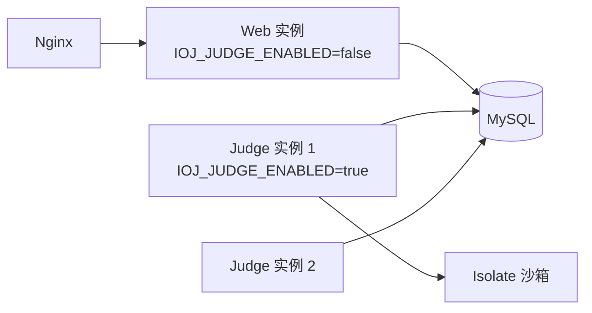

# 部署与运维

## 1. 环境要求

| 组件 | 版本 | 说明 |
| --- | --- | --- |
| JDK | 21 | 编译与运行判题都依赖 `javac` |
| MySQL | 8.0+ | 需要支持 `FOR UPDATE`、`utf8mb4` |
| Maven | 3.9+（或用仓库自带 `./mvnw`） | 构建 |
| 判题工具链 | `g++`（C++17）、`gcc`（C11）、`python3` | 按需要的语言安装 |
| 判题沙箱 | Isolate（默认引擎） | `isolate.service` 运行中，运行用户可执行 `/usr/bin/isolate` |
| 系统 | Linux | 判题依赖 cgroup v2、`/bin/bash`；本机进程回退模式还依赖 `ulimit` |

```bash
# Debian/Ubuntu 判题机依赖
sudo apt install -y openjdk-21-jdk maven g++ gcc python3 isolate
sudo systemctl enable --now isolate.service
sudo usermod -aG isolate "$USER"     # 官方包是 setuid，非必需；收紧权限时使用，改后需重新登录
isolate --check-config
```

## 2. 初始化数据库

```bash
mysql -uroot -p <<'SQL'
CREATE DATABASE ioj DEFAULT CHARACTER SET utf8mb4 COLLATE utf8mb4_general_ci;
CREATE USER 'ioj'@'localhost' IDENTIFIED BY '你的强密码';
GRANT ALL PRIVILEGES ON ioj.* TO 'ioj'@'localhost';
FLUSH PRIVILEGES;
SQL

mysql -uioj -p ioj < server/src/main/resources/db/schema.sql
mysql -uioj -p ioj < server/src/main/resources/db/seed.sql   # admin / admin123456，登录后立刻改密码
```

> `seed.sql` 可重复执行（内部使用 `INSERT IGNORE`）；`schema.sql` 重复执行会报表已存在。
> 需要清空重来时：`DROP DATABASE ioj; CREATE DATABASE ioj DEFAULT CHARACTER SET utf8mb4 COLLATE utf8mb4_general_ci;` 然后重新执行两个脚本。
>
> 生产库建议把 `max_allowed_packet` 保持默认 64MB 或更大，以容纳较大的测试点与源码。

## 3. 配置项

所有配置都有默认值，生产环境用环境变量覆盖即可（`application.yaml` 已写好 `${...}` 占位）。

| 环境变量 | 默认值 | 说明 |
| --- | --- | --- |
| `IOJ_DB_HOST` / `IOJ_DB_PORT` / `IOJ_DB_NAME` | `127.0.0.1` / `3306` / `ioj` | 数据库地址 |
| `IOJ_DB_USER` / `IOJ_DB_PASSWORD` | `ioj` / `ioj` | **必须覆盖** |
| `IOJ_JWT_SECRET` | 开发用弱密钥 | **必须覆盖**，≥ 32 字节（否则启动失败） |
| `IOJ_CORS_ORIGINS` | `http://localhost:5173` | 前端地址，多个用逗号分隔 |
| `IOJ_PROBLEM_AUTO_PUBLISH` | `true` | 普通用户上传的题目是否直接发布；对外开放注册时建议 `false` |
| `IOJ_PROBLEM_MAX_TESTCASE_BYTES` | `4194304` | 单条测试点 `input`/`output` 各自的上限（UTF-8 字节，默认 4 MiB） |
| `IOJ_SUBMISSION_MAX_CODE_LENGTH` | `65536` | 单次提交代码字符数上限 |
| `IOJ_JUDGE_ENABLED` | `true` | 是否启用判题 worker |
| `IOJ_JUDGE_ENGINE` | `isolate` | 判题引擎：`isolate`（默认）/ `local`（本机进程回退） |
| `IOJ_JUDGE_CONCURRENCY` | `1` | 同时判题数，建议 CPU 核数 - 1 |
| `IOJ_JUDGE_CHECKER_ENABLED` | `true` | 是否允许题目自带判题器（Special Judge）；关闭后带 checker 的题统一判 `CHECKER_ERROR` |
| `IOJ_JUDGE_CHECKER_TIME_LIMIT_MS` / `IOJ_JUDGE_CHECKER_MEMORY_LIMIT_MB` | `2000` / `512` | 判题器单次运行的 CPU / 内存限制，**与题限无关**（超限判 `CHECKER_ERROR`，不算选手 TLE/MLE） |
| `ioj.datasource-check.enabled`（yaml） | `true` | 启动时做一次数据库连通性自检；失败会打印实际生效的 URL/用户名并终止启动 |

其余可调项（测试点上限、代码长度、判题超时等）见 `application.yaml` 中的 `ioj.problem`、`ioj.submission`、`ioj.judge`。

生成一个合格的密钥：

```bash
openssl rand -base64 48
```

## 4. 构建与启动

```bash
cd server
./mvnw -DskipTests clean package
ls target/server-0.0.1-SNAPSHOT.jar

# 前台试运行（数据库账号不是默认 ioj 时，按需补上 IOJ_DB_USER / IOJ_DB_PASSWORD / IOJ_DB_NAME）
IOJ_DB_USER=your_db_user \
IOJ_DB_PASSWORD='...' \
IOJ_DB_NAME=ioj \
IOJ_JWT_SECRET='...' \
java -jar target/server-0.0.1-SNAPSHOT.jar

# 也可以直接用 Maven 跑
IOJ_DB_USER=your_db_user IOJ_DB_PASSWORD='...' IOJ_JWT_SECRET='...' ./mvnw spring-boot:run
```

### systemd 托管

`/etc/systemd/system/ioj.service`：

```ini
[Unit]
Description=iOJ server
After=network.target mysql.service

[Service]
Type=simple
User=ioj
WorkingDirectory=/opt/ioj
Environment=IOJ_DB_USER=ioj
Environment=IOJ_DB_PASSWORD=改成你的密码
Environment=IOJ_JWT_SECRET=改成至少32字节的随机串
Environment=IOJ_CORS_ORIGINS=https://oj.example.com
Environment=IOJ_JUDGE_CONCURRENCY=2
ExecStart=/usr/bin/java -Xms256m -Xmx512m -jar /opt/ioj/server.jar
Restart=always
RestartSec=5
LimitNOFILE=65536

[Install]
WantedBy=multi-user.target
```

```bash
sudo systemctl daemon-reload && sudo systemctl enable --now ioj
sudo journalctl -u ioj -f
```

> 用 systemd 的 `User=ioj` 启动（非 root），判题产生的临时目录也以该用户身份运行，降低风险。

## 5. Nginx 反向代理

```nginx
server {
    listen 443 ssl http2;
    server_name oj.example.com;

    ssl_certificate     /etc/letsencrypt/live/oj.example.com/fullchain.pem;
    ssl_certificate_key /etc/letsencrypt/live/oj.example.com/privkey.pem;

    # 前端静态资源
    root /var/www/ioj;
    index index.html;
    location / { try_files $uri $uri/ /index.html; }

    # 后端
    location /api/ {
        proxy_pass http://127.0.0.1:8080;
        proxy_set_header Host $host;
        proxy_set_header X-Real-IP $remote_addr;
        proxy_set_header X-Forwarded-For $proxy_add_x_forwarded_for;
        proxy_set_header X-Forwarded-Proto $scheme;
        client_max_body_size 16m;     # 单条测试点默认 4 MiB；批量上传请按总量再调大
        proxy_read_timeout 60s;
    }
}
```

注意：

- 前后端同域部署时 CORS 基本不会触发；分域部署时需要把前端域名加到 `IOJ_CORS_ORIGINS`。
- 前端图片/题面里的 Markdown 由前端渲染，后端不做 HTML 转义，注意前端的 XSS 处理（推荐 DOMPurify）。

## 6. 判题机部署建议

判题机需要 Isolate 与对应语言工具链。以 Debian 13 为例：

```bash
sudo apt install isolate g++ gcc python3 openjdk-21-jdk
sudo systemctl enable --now isolate.service
sudo usermod -aG isolate <运行后端的用户>   # 官方包是 setuid，非必需；收紧权限时使用，改后需重新登录
isolate --check-config
```

- 运行后端的用户必须能执行 `/usr/bin/isolate`；否则启动时会报 `isolate binary is not executable`。
- Debian 的 JDK 需要把 `/etc/java-21-openjdk` 只读绑定进沙箱（已作为默认 `extra-dirs`）。
- `box-id-start` 默认从 1 开始，避开 root 手工测试留下的 box 0；多判题实例请分配不同区间。
- 详细安装与验证命令见 [06-isolate.md](06-isolate.md)。

小规模（单机）：

```
[ Nginx ] → [ Spring Boot（Web + Judge） ] → [ MySQL ]
```

判题压力大或对安全要求高时拆开：



注意：

- 判题实例启动时会把**所有** `JUDGING` 重置为 `PENDING`。多判题实例场景下，重启其中一个会把另一个正在判的提交重新排队（会重复判一次，但结果最终一致）。如果介意，改成只重置 `judged_at IS NULL AND created_at < NOW() - INTERVAL 10 MINUTE`。
- 判题实例不需要对外开放端口。
- 多个判题实例之间 `box-id-start` / `box-id-count` 不能重叠。

## 7. 备份与恢复

```bash
# 每天凌晨备份（保留 14 天）
mysqldump -uioj -p'密码' --single-transaction --routines --triggers ioj \
  | gzip > /backup/ioj-$(date +%F).sql.gz
find /backup -name 'ioj-*.sql.gz' -mtime +14 -delete

# 恢复
gunzip -c /backup/ioj-2026-10-29.sql.gz | mysql -uioj -p'密码' ioj
```

测试点在数据库里，所以**备份数据库就等于备份了全部数据**（这是选择 DB 存测试点的主要收益）。

## 8. 日志与监控

- 应用日志：`journalctl -u ioj`（或重定向到文件）。判题完成日志形如 `判题完成 submissionId=1 status=ACCEPTED`。
- 建议监控：
  - 待判队列：`SELECT COUNT(*) FROM submissions WHERE status='PENDING'`
  - 卡住的任务：`SELECT COUNT(*) FROM submissions WHERE status='JUDGING' AND created_at < NOW() - INTERVAL 5 MINUTE`
  - 判题失败率：`SELECT status, COUNT(*) FROM submissions GROUP BY status`
  - 磁盘：`/tmp`（判题临时目录）与 MySQL 数据目录
- 健康检查：任意公开接口，例如 `GET /api/v1/meta/languages` 返回 200 即代表 Web 与数据库正常（暂无 actuator 依赖）。

## 9. 升级流程

```bash
cd server && git pull && ./mvnw -DskipTests clean package
sudo systemctl stop ioj
sudo cp target/server-0.0.1-SNAPSHOT.jar /opt/ioj/server.jar
sudo systemctl start ioj
```

涉及表结构变更时，**先**在低峰期执行新增列/新增表的 SQL（当前脚本不含迁移工具，建议后续引入 Flyway）。

## 10. 上线安全检查清单

- [ ] `IOJ_JWT_SECRET` 已替换为随机 48 字节，且不写在仓库里
- [ ] 数据库密码已替换，MySQL 只监听内网/本机
- [ ] 管理员密码已从 `admin123456` 改掉
- [ ] `IOJ_PROBLEM_AUTO_PUBLISH` 按开放程度设置
- [ ] 判题机已安装 Isolate，`isolate.service` 为 active，运行用户能执行 `isolate --version`，`isolate --check-config` 通过
- [ ] 需要公网开放注册时，未使用 `engine=local` 回退（回退模式无法防 fork bomb/网络访问）
- [ ] Nginx 已开启 HTTPS；`client_max_body_size` 足够上传测试数据
- [ ] 备份任务已配置并验证过一次恢复
- [ ] 判题用户为非 root，`/tmp` 有独立配额或定期清理
- [ ] 服务器时间同步（`timedatectl`），否则 JWT 过期时间会漂移

## 11. 常见启动错误排查

### `CannotCreateTransactionException: Could not open JDBC Connection for transaction`

这是"拿不到数据库连接"的统一外壳，真正原因在日志里的 `Caused by`：

| Caused by | 含义 | 处理 |
| --- | --- | --- |
| `Access denied for user 'ioj'@'localhost' (using password: YES)` | 进程仍在用默认账号 `ioj/ioj`，说明 `IOJ_DB_USER` / `IOJ_DB_PASSWORD` 没生效 | 确认变量设置在**实际启动的进程**上（IDEA Run Configuration / systemd / 当前 shell） |
| `Access denied for user 'xxx '@'localhost'` | 用户名或密码值前后带了空格/引号 | 去掉引号与多余空格 |
| `Unknown database 'ioj '` | `IOJ_DB_NAME` 值里带了空格或分号 | 同上 |
| `Communications link failure` / `Connection refused` | `IOJ_DB_HOST/PORT` 不对，或 MySQL 未启动/未监听 TCP | `ss -ltnp \| grep 3306`，也可以改 `IOJ_DB_HOST=127.0.0.1` |
| `Public Key Retrieval is not allowed` | 自定义 JDBC URL 时丢了参数 | 保留 `allowPublicKeyRetrieval=true&useSSL=false` |

本项目在启动阶段会先做一次连通性自检（`DataSourceHealthCheck`）：

- 成功：`数据库连接正常: MySQL 8.4.11，当前库=ioj，账号=yuchenxi@localhost`
- 失败：打印**实际生效的 JDBC URL 与用户名**（不打印密码）并终止启动，不会再拖到第一个请求才报错

三种正确的环境变量写法：

```bash
# 1) bash：一行一个 export（不要用分号把它们串成一行）
export IOJ_DB_HOST=localhost
export IOJ_DB_NAME=ioj
export IOJ_DB_USER=yuchenxi
export IOJ_DB_PASSWORD='your_password'
export IOJ_JWT_SECRET="$(openssl rand -base64 48)"
cd server && ./mvnw spring-boot:run
```

```text
2) IntelliJ IDEA：Run/Debug Configurations → Environment variables
   分号分隔，等号两边不要空格：
   IOJ_DB_HOST=localhost;IOJ_DB_NAME=ioj;IOJ_DB_USER=yuchenxi;IOJ_DB_PASSWORD=your_password;IOJ_JWT_SECRET=...
```

```ini
# 3) systemd
Environment=IOJ_DB_HOST=localhost
Environment=IOJ_DB_NAME=ioj
Environment=IOJ_DB_USER=yuchenxi
Environment=IOJ_DB_PASSWORD=your_password
```

> 反例：`export IOJ_DB_HOST=localhost; IOJ_DB_NAME=ioj; IOJ_DB_USER=...` 在 bash 里只有第一个是 `export`，
> 后面的 `IOJ_DB_NAME=ioj` 会被当成"临时变量 + 空命令"，进程最终仍使用默认账号 `ioj/ioj`，
> 于是日志出现 `Access denied for user 'ioj'@'localhost'`。

