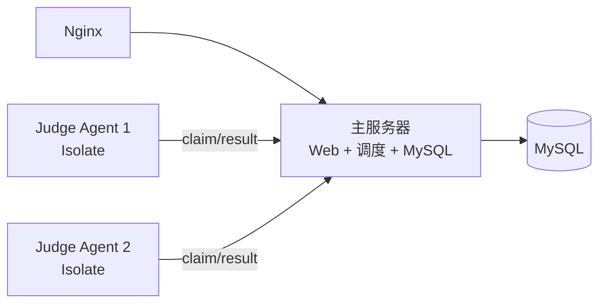

# 部署与运维

本文说明 iOJ 主服务器与判题机的环境要求、数据库初始化、环境变量、systemd/Nginx、备份恢复、升级回滚和上线检查，读者为部署与运维人员。判题机的 Isolate 细节见 [Isolate 沙箱运维](06-isolate.md)，Agent 细节见 [判题 Agent 部署与运维](07-judge-agent.md)。

> 返回目录：[后端文档索引](README.md)

## 1. 环境要求

| 组件 | 版本 | 说明 |
| --- | --- | --- |
| JDK | 21 | 主服务器和 Agent 都运行 Java 21 |
| MySQL | 8.0+ | 主服务器使用；需要支持 `FOR UPDATE`、`utf8mb4` |
| Maven | 3.9+（或用仓库自带 `./mvnw`） | 构建 |
| 判题工具链 | `g++`（C++17）、`gcc`（C11）、`python3` | **仅判题机**按需要的语言安装 |
| 判题沙箱 | Isolate | **仅判题机**：`isolate.service` 运行中，Agent 用户可执行 `/usr/bin/isolate` |
| 系统 | Linux | 主服务器可用 Linux；判题机依赖 cgroup v2、`/bin/bash` |

```bash
# Debian/Ubuntu 判题机依赖
sudo apt install -y openjdk-21-jdk g++ gcc python3 isolate
sudo systemctl enable --now isolate.service
sudo usermod -aG isolate "$USER"     # 官方包是 setuid，非必需；收紧权限时使用，改后需重新登录
isolate --check-config
```

> 如果发行版仓库没有 `isolate` 包，按 [Isolate 沙箱运维](06-isolate.md) 添加官方仓库或从源码安装。

## 2. 初始化数据库

以下命令在**仓库根目录**执行；数据库密码用强随机值替换 `<db-password>`：

```bash
mysql -uroot -p <<'SQL'
CREATE DATABASE ioj DEFAULT CHARACTER SET utf8mb4 COLLATE utf8mb4_general_ci;
CREATE USER 'ioj'@'localhost' IDENTIFIED BY '<db-password>';
GRANT ALL PRIVILEGES ON ioj.* TO 'ioj'@'localhost';
FLUSH PRIVILEGES;
SQL

mysql -uioj -p ioj < server/src/main/resources/db/schema.sql
mysql -uioj -p ioj < server/src/main/resources/db/seed.sql   # admin / admin123456，登录后立刻改密码
```

> 已有数据库升级到分布式判题时，不要重跑 `schema.sql`；在仓库根目录先执行一次：
>
> ```bash
> mysqldump -uioj -p --single-transaction ioj > ioj-before-distributed-judge.sql
> mysql -uioj -p ioj < server/src/main/resources/db/migrate-distributed-judge.sql
> ```
>
> 迁移脚本会新增 `judge_keys`、`judge_nodes` 和 `submissions` 的租约字段。执行前务必确认已备份。

> `seed.sql` 可重复执行（内部使用 `INSERT IGNORE`）；`schema.sql` 重复执行会报表已存在。
>
> **破坏性操作**：需要清空重来时执行 `DROP DATABASE ioj;` 再 `CREATE DATABASE ioj DEFAULT CHARACTER SET utf8mb4 COLLATE utf8mb4_general_ci;`，然后重新执行两个脚本。该操作会删除整个 `ioj` 库的用户、题目、测试数据、提交和判题 key；执行前必须备份。
>
> 生产库建议把 `max_allowed_packet` 保持默认 64 MB 或更大，以容纳较大的测试点与源码。

## 3. 配置项

所有配置都有默认值，生产环境用环境变量覆盖即可（`application.yaml` 已写好 `${...}` 占位）。

> **凭据要求**：`application-deployment.yml` 只应包含占位符或开发默认值。生产部署必须用环境变量覆盖数据库、JWT、SMTP 与判题 key；如果真实凭据曾经进入 Git 历史，应立即轮换，不能只删除文件内容。

| 环境变量 | 默认值 | 说明 |
| --- | --- | --- |
| `IOJ_DB_HOST` / `IOJ_DB_PORT` / `IOJ_DB_NAME` | `127.0.0.1` / `3306` / `ioj` | 数据库地址 |
| `IOJ_DB_USER` / `IOJ_DB_PASSWORD` | `ioj` / `ioj` | **必须覆盖** |
| `IOJ_JWT_SECRET` | 开发用弱密钥 | **必须覆盖**，≥ 32 字节（否则启动失败） |
| `IOJ_CORS_ORIGINS` | `http://localhost:5173` | 前端地址，多个用逗号分隔 |
| `IOJ_PROBLEM_AUTO_PUBLISH` | `true` | 普通用户上传的题目是否直接发布；对外开放注册时建议 `false` |
| `IOJ_PROBLEM_MAX_TESTCASES` | `100` | 单题测试点数量上限 |
| `IOJ_PROBLEM_MAX_TESTCASE_BYTES` | `4194304` | 单条测试点 `input`/`output` 各自的上限（UTF-8 字节，默认 4 MiB） |
| `IOJ_SUBMISSION_MAX_CODE_LENGTH` | `65536` | 单次提交代码字符数上限 |
| `IOJ_JUDGE_ENABLED` | `true` | 仅 `local` 模式使用；关闭后本地 worker 不消费任务 |
| `IOJ_JUDGE_MODE` | `remote` | `remote` 主服务器调度；`local` 仅测试/本地开发 |
| `IOJ_JUDGE_ENGINE` | `none` | 主服务器默认 `none`；Agent 设为 `isolate` |
| `IOJ_JUDGE_LEASE_SECONDS` | `300` | Agent 任务租约时长 |
| `IOJ_JUDGE_MAX_ATTEMPTS` | `3` | 任务最多被领取次数 |
| `IOJ_JUDGE_REAPER_INTERVAL_MS` | `30000` | 过期租约回收间隔 |
| `IOJ_JUDGE_NODE_OFFLINE_SECONDS` | `90` | 节点心跳超时后标记离线 |
| `IOJ_JUDGE_MAX_CLAIM_BATCH` | `10` | 单次 claim 最多返回任务数（服务端上限） |
| `IOJ_JUDGE_INLINE_MAX_BYTES` | `1048576` | 测试数据总字节数超过该值时改用 ZIP bundle 下载 |
| `IOJ_JUDGE_CONCURRENCY` | `1` | 主服务器 local 模式或 Agent 并发数 |
| `IOJ_JUDGE_CHECKER_ENABLED` | `true` | 是否允许题目自带判题器（Special Judge）；关闭后带 checker 的题统一判 `CHECKER_ERROR` |
| `IOJ_JUDGE_CHECKER_TIME_LIMIT_MS` / `IOJ_JUDGE_CHECKER_MEMORY_LIMIT_MB` | `2000` / `512` | 判题器单次运行的 CPU / 内存限制，**与题限无关**（超限判 `CHECKER_ERROR`，不算选手 TLE/MLE） |
| `IOJ_JUDGE_CHECKER_COMPILE_TIMEOUT_MS` / `IOJ_JUDGE_CHECKER_COMPILE_MEMORY_MB` | `30000` / `512` | 判题器编译的墙钟超时 / 内存限制 |
| `ioj.datasource-check.enabled`（yaml） | `true` | 启动时做一次数据库连通性自检；失败会打印实际生效的 URL/用户名并终止启动 |
| `IOJ_MAIL_HOST` / `IOJ_MAIL_PORT` | `smtp.localhost.invalid` / `25` | SMTP 服务器。默认值不可解析，**生产必须覆盖**，否则发码直接返回 `2009` |
| `IOJ_MAIL_USERNAME` / `IOJ_MAIL_PASSWORD` | 空 | SMTP 认证信息；用 465/587 端口时通常都需要 |
| `IOJ_MAIL_SMTP_AUTH` / `IOJ_MAIL_SSL` / `IOJ_MAIL_STARTTLS` | `false` / `false` / `false` | 加密与认证开关：465 用 SSL，587 用 STARTTLS |
| `IOJ_MAIL_FROM` | `no-reply@localhost` | 发件人地址。多数 SMTP 服务要求 From 与认证账号同域，否则拒收 |
| `IOJ_EMAIL_CODE_ENABLED` | `true` | 注册是否必须邮箱验证。设 `false` 时 `POST /auth/email-codes` 直接返回 `1000`，注册也不再校验验证码 |
| `IOJ_EMAIL_CODE_TTL_MINUTES` | `10` | 验证码有效期（分钟） |
| `IOJ_EMAIL_CODE_RESEND_INTERVAL_SECONDS` | `60` | 同一邮箱的重发冷却（秒） |
| `IOJ_EMAIL_CODE_MAX_PER_HOUR` | `5` | 同一邮箱每小时最多发码次数（超过返回 `2008`） |
| `IOJ_EMAIL_CODE_MAX_ATTEMPTS` | `5` | 单个验证码允许输错的次数；达到上限立即作废，之后即使输对也要求重新获取 |
| `IOJ_EMAIL_CODE_SUBJECT` / `IOJ_EMAIL_CODE_SUBJECT_RESET` | `iOJ 邮箱验证码` / `iOJ 找回密码验证码` | 注册与找回密码邮件的主题 |
| `IOJ_CAPTCHA_ENABLED` | `true` | 是否启用图形验证码；关闭后登录/发码不再要求验证码，签发接口返回 `1000` |
| `IOJ_CAPTCHA_TTL_SECONDS` | `120` | 图形验证码有效期 |
| `IOJ_CAPTCHA_MAX_ATTEMPTS` | `3` | 单张图形验证码最大输错次数 |
| `IOJ_CAPTCHA_CODE_LENGTH` | `5` | 图片字符数 |
| `IOJ_CAPTCHA_ISSUE_PER_MINUTE_PER_IP` / `IOJ_CAPTCHA_ISSUE_PER_HOUR_PER_IP` | `60` / `600` | 单 IP 申请图形验证码的分钟/小时上限 |
| `IOJ_CAPTCHA_CLEANUP_RETENTION_HOURS` | `24` | 过期图形验证码保留时间 |

### SMTP 与发件配置

```bash
# 465（隐式 SSL，最常见）
IOJ_MAIL_HOST=smtp.example.com
IOJ_MAIL_PORT=465
IOJ_MAIL_USERNAME=no-reply@example.com
IOJ_MAIL_PASSWORD='授权码/密码'
IOJ_MAIL_SMTP_AUTH=true
IOJ_MAIL_SSL=true
IOJ_MAIL_FROM='iOJ <no-reply@example.com>'

# 587（STARTTLS）
IOJ_MAIL_PORT=587
IOJ_MAIL_SSL=false
IOJ_MAIL_STARTTLS=true
```

- 发件域名建议配好 SPF/DKIM，否则验证码邮件容易进垃圾箱（这一步在 DNS 侧，不在本仓库）。
- 仓库中的 `application-deployment.yml` 不应包含真实 SMTP 账号密码；生产环境必须用 `IOJ_MAIL_*` 覆盖。若真实凭据曾提交到 Git，立即在邮件服务商处轮换。
- 发信是**同步**的（在请求线程里发），SMTP 超时被限制为 connection 5 s / read 10 s / write 10 s；SMTP 挂掉时表现为发码接口 `503` + `2009`，不会拖住整个服务。
- 自测：`curl -s -X POST localhost:8082/api/v1/auth/email-codes -H 'Content-Type: application/json' -d '{"email":"you@example.com"}'`，同时 `journalctl -u ioj -f` 看 `验证码已发送 email=...`。
- `IOJ_EMAIL_CODE_ENABLED=false` 可用于临时关掉验证（例如 SMTP 还没配好、需要先开放注册）；关闭后旧验证码也不再校验。

其余可调项（测试点上限、代码长度、判题超时等）见 `application.yaml` 中的 `ioj.problem`、`ioj.submission`、`ioj.judge`。

生成一个合格的密钥：

```bash
openssl rand -base64 48
```

## 4. 构建与启动

```bash
# 在仓库根目录执行
./mvnw -DskipTests clean package
ls server/target/server-0.0.1-SNAPSHOT.jar
ls judge-agent/target/judge-agent-0.0.1-SNAPSHOT.jar

# 启动主服务器（主服务器不再需要 Isolate）
IOJ_DB_USER=your_db_user \
IOJ_DB_PASSWORD='...' \
IOJ_DB_NAME=ioj \
IOJ_JWT_SECRET='...' \
java -jar server/target/server-0.0.1-SNAPSHOT.jar
```

### systemd 托管主服务器

以下示例假设已创建非 root 系统用户 `ioj`（主服务器）和 `judge`（判题机），并准备好应用目录：

```bash
# 主服务器
sudo useradd --system --home /opt/ioj --shell /usr/sbin/nologin ioj
sudo install -d -o ioj -g ioj /opt/ioj

# 判题机
sudo useradd --system --home /opt/ioj-agent --shell /usr/sbin/nologin judge
sudo install -d -o judge -g judge /opt/ioj-agent
```

把环境变量放在权限为 `0640`、属主为服务用户的 `EnvironmentFile` 中，不要把密码或密钥写进 unit 文件：

```bash
# 把 ioj 换成实际运行用户/组；文件对服务用户可读、对其他用户不可读
sudo install -d -m 0755 /etc/ioj
sudo install -m 0640 -o root -g ioj /dev/null /etc/ioj/server.env
sudo editor /etc/ioj/server.env
```

`/etc/ioj/server.env` 示例（值全部替换为真实值，不要提交到 Git）：

```bash
IOJ_DB_HOST=127.0.0.1
IOJ_DB_PORT=3306
IOJ_DB_NAME=ioj
IOJ_DB_USER=<db-user>
IOJ_DB_PASSWORD=<db-password>
IOJ_JWT_SECRET=<at-least-32-bytes>
IOJ_CORS_ORIGINS=https://<frontend-host>
IOJ_JUDGE_MODE=remote
IOJ_JUDGE_ENGINE=none
IOJ_MAIL_HOST=<smtp-host>
IOJ_MAIL_PORT=465
IOJ_MAIL_USERNAME=<smtp-user>
IOJ_MAIL_PASSWORD=<smtp-password>
IOJ_MAIL_SMTP_AUTH=true
IOJ_MAIL_SSL=true
IOJ_MAIL_FROM=no-reply@example.com
```

`/etc/systemd/system/ioj.service`：

```ini
[Unit]
Description=iOJ server
After=network.target mysql.service

[Service]
Type=simple
User=ioj
WorkingDirectory=/opt/ioj
EnvironmentFile=/etc/ioj/server.env
ExecStart=/usr/bin/java -Xms256m -Xmx512m -jar /opt/ioj/server.jar --spring.profiles.active=deployment
Restart=on-failure
RestartSec=5
SuccessExitStatus=143
LimitNOFILE=65536

[Install]
WantedBy=multi-user.target
```

```bash
sudo systemctl daemon-reload && sudo systemctl enable --now ioj
sudo journalctl -u ioj -f
```

> `deployment` profile 将端口改为 `8082`、`ioj.problem.auto-publish` 改为 `false`，并追加生产 CORS 来源和一组 SMTP 预设。SMTP 预设必须用环境变量覆盖，不要依赖仓库默认值。若不需要这些差异，可以去掉 `--spring.profiles.active=deployment`，并相应调整 Nginx 的 `proxy_pass` 端口。

> 主服务器不需要安装 Isolate，也不需要 `IOJ_JUDGE_CONCURRENCY`；判题能力来自 Agent。

### 判题 Agent 部署

判题机安装 Isolate 和工具链后，部署 `judge-agent.jar`：

```ini
# /etc/systemd/system/ioj-judge-agent.service
[Unit]
Description=iOJ judge agent
After=network.target isolate.service
Requires=isolate.service
StartLimitIntervalSec=300
StartLimitBurst=5

[Service]
Type=simple
User=judge
WorkingDirectory=/opt/ioj-agent
EnvironmentFile=/etc/ioj/judge-agent.env
ExecStart=/usr/bin/java -Xms128m -Xmx512m -jar /opt/ioj-agent/judge-agent.jar
Restart=on-failure
RestartPreventExitStatus=78
RestartSec=5
LimitNOFILE=65536

[Install]
WantedBy=multi-user.target
```

`/etc/ioj/judge-agent.env`（权限 `0640`，属主为运行 Agent 的用户/组）：

```bash
sudo install -m 0640 -o root -g judge /dev/null /etc/ioj/judge-agent.env
sudo editor /etc/ioj/judge-agent.env
```

```bash
IOJ_JUDGE_SERVER_URL=http://<server-internal-ip>:8080
IOJ_JUDGE_KEY=<judge-key>
IOJ_JUDGE_NODE_ID=judge-1
IOJ_JUDGE_CONCURRENCY=2
IOJ_ISOLATE_BOX_ID_START=1
IOJ_ISOLATE_BOX_ID_COUNT=2
```

```bash
sudo systemctl daemon-reload && sudo systemctl enable --now ioj-judge-agent
sudo journalctl -u ioj-judge-agent -f
```

Agent 启动时会先拉取 `/internal/judge/config`，按主服务器的 `requiredLanguages` 逐项探测工具链；缺少任意一种语言会以退出码 `78` 拒绝启动，不会先发心跳或 claim。安装对应工具包后重启即可。

- 一个 Agent 进程使用一个 key 和一个 `nodeId`
- 同一台机器跑多个 Agent 时，给每个进程分配不同的 `IOJ_ISOLATE_BOX_ID_START` / `IOJ_ISOLATE_BOX_ID_COUNT`
- Agent 只需要出站访问主服务器，不需要公网入站端口

## 5. Nginx 反向代理

```nginx
server {
    listen 443 ssl http2;
    server_name oj.example.com;

    ssl_certificate     /etc/letsencrypt/live/oj.example.com/fullchain.pem;
    ssl_certificate_key /etc/letsencrypt/live/oj.example.com/privkey.pem;

    # 前端静态资源
    root /var/www/oj;
    index index.html;
    location / { try_files $uri $uri/ /index.html; }

    # 后端
    location /api/ {
        proxy_pass http://127.0.0.1:8082;
        proxy_set_header Host $host;
        proxy_set_header X-Real-IP $remote_addr;
        proxy_set_header X-Forwarded-For $proxy_add_x_forwarded_for;
        proxy_set_header X-Forwarded-Proto $scheme;
        client_max_body_size 16m;     # 单条测试点默认 4 MiB；批量上传请按总量再调大
        proxy_read_timeout 60s;
    }
}
```

注意：

- **不要给公网 Nginx 增加 `location /internal/`**。判题 Agent 应通过内网地址访问主服务器（例如 `http://<server-ip>:8082`），或者单独开一个只允许判题网段的内部 server block。若必须经 Nginx 转发，至少限制来源 IP：

  ```nginx
  location /internal/judge/ {
      allow <judge-agent-ip>;
      deny all;
      proxy_pass http://127.0.0.1:8082;
      proxy_set_header X-Forwarded-For $proxy_add_x_forwarded_for;
  }
  ```
- 前后端同域部署时 CORS 基本不会触发；分域部署时需要把前端域名加到 `IOJ_CORS_ORIGINS`。
- `X-Forwarded-For` 必须由可信 Nginx 设置；后端已开启 `server.forward-headers-strategy=framework`，图形验证码的按 IP 限流依赖这里拿到真实客户端 IP。不要把 8080 直接暴露到公网。
- 前端图片/题面里的 Markdown 由前端渲染，后端不做 HTML 转义，注意前端的 XSS 处理（推荐 DOMPurify）。

## 6. 判题机部署建议

判题机需要 Isolate 与对应语言工具链。以 Debian 13 为例：

```bash
sudo apt install isolate g++ gcc python3 openjdk-21-jdk
sudo systemctl enable --now isolate.service
sudo usermod -aG isolate <运行 Agent 的用户>   # 官方包是 setuid，非必需；收紧权限时使用，改后需重新登录
isolate --check-config
```

- 运行 Agent 的用户必须能执行 `/usr/bin/isolate`；否则启动时会报 `isolate binary is not executable`。
- Debian 的 JDK 需要把 `/etc/java-21-openjdk` 只读绑定进沙箱（已作为默认 `extra-dirs`）。
- `box-id-start` 默认从 1 开始，避开 root 手工测试留下的 box 0；同一台机器多个 Agent 请分配不同区间。
- 详细安装与验证命令见 [06-isolate.md](06-isolate.md)。

推荐拓扑：



注意：

- 主服务器 `ioj.judge.mode=remote`，默认 `ioj.judge.engine=none`，不加载 Isolate。
- Agent 不需要对外开放端口，只需要能出站访问主服务器的内部 API。
- 同一台机器多个 Agent 的 `box-id-start` / `box-id-count` 不能重叠。
- 任务租约过期由主服务器的 `JudgeLeaseReaper` 回收；Agent 重启不会重置其他 Agent 的任务。
- 一个 key 对应一个 `nodeId`；更换 key 或 nodeId 时先停旧 Agent，再启用新 key。

## 7. 备份与恢复

```bash
# 每天凌晨备份（保留 14 天）
mysqldump -uioj -p'<db-password>' --single-transaction --routines --triggers ioj \
  | gzip > /backup/ioj-$(date +%F).sql.gz
find /backup -name 'ioj-*.sql.gz' -mtime +14 -delete

# 恢复
gunzip -c /backup/ioj-2026-10-29.sql.gz | mysql -uioj -p'<db-password>' ioj
```

测试点在数据库里，所以**备份数据库就等于备份了全部数据**（这是选择 DB 存测试点的主要收益）。

## 8. 日志与监控

- 主服务器日志：`journalctl -u ioj`。判题完成日志形如 `远程判题完成 submissionId=1 status=ACCEPTED keyId=1 nodeId=judge-1`。
- Agent 日志：`journalctl -u ioj-judge-agent`。启动日志包含 `nodeId`、server URL、并发和语言。
- 建议监控：
  - 待判队列：`SELECT COUNT(*) FROM submissions WHERE status='PENDING'`
  - 卡住的任务：`SELECT COUNT(*) FROM submissions WHERE status='JUDGING' AND lease_expires_at < NOW()`
  - 判题失败率：`SELECT status, COUNT(*) FROM submissions GROUP BY status`
  - 在线节点：`SELECT COUNT(*) FROM judge_nodes WHERE status='ONLINE'`
  - 判题机磁盘：`/tmp`（判题临时目录）与 `/var/lib/isolate`
- 健康检查：主服务器任意公开接口，例如 `GET /api/v1/meta/languages` 返回 200；节点状态用 `GET /api/v1/admin/judge-nodes`（管理员）。

## 9. 升级与回滚

升级前先备份数据库和当前 jar：

```bash
mysqldump -uioj -p'<db-password>' --single-transaction --routines --triggers ioj \
  | gzip > /backup/ioj-before-upgrade-$(date +%F-%H%M).sql.gz
sudo cp /opt/ioj/server.jar /opt/ioj/server.jar.bak
```

```bash
# 在仓库根目录执行；主服务器
git pull
./mvnw -B -pl server -am clean package
sudo systemctl stop ioj
sudo cp server/target/server-0.0.1-SNAPSHOT.jar /opt/ioj/server.jar
sudo systemctl start ioj

# 判题机（逐台滚动升级；先停一台，升级后确认节点重新上线）
./mvnw -B -pl judge-agent -am clean package
sudo systemctl stop ioj-judge-agent
sudo cp judge-agent/target/judge-agent-0.0.1-SNAPSHOT.jar /opt/ioj-agent/judge-agent.jar
sudo systemctl start ioj-judge-agent
```

回滚：

```bash
# 只回滚程序：恢复旧 jar 后重启
sudo systemctl stop ioj
sudo cp /opt/ioj/server.jar.bak /opt/ioj/server.jar
sudo systemctl start ioj

# 如果本次升级执行了不兼容的数据库迁移，程序回滚后仍需恢复升级前的数据库备份
gunzip -c /backup/ioj-before-upgrade-<timestamp>.sql.gz | mysql -uioj -p'<db-password>' ioj
```

> 恢复数据库会覆盖升级后产生的数据；只有在确认数据可以丢弃或已另行迁移时才能执行。升级顺序建议：若协议版本变更则不兼容旧 Agent，需要同时升级主服务器和 Agent；协议兼容时再按“主服务器兼容旧协议 → 逐台升级 Agent”的顺序。排障先看 `ProtocolVersion` 和发布说明。

### 9.1 CI 部署

仓库提供两个 GitHub Actions 工作流，它们只是把上述步骤自动化，不是唯一部署方式：

| 工作流 | 触发 | 做什么 |
| --- | --- | --- |
| `.github/workflows/deploy-server.yml` | `main` 分支上 `server/`、`judge-protocol/`、`judge-core/`、父 POM 或工作流自身变化 | SSH 到部署机，拉取对应 commit，执行 `./mvnw -B -pl server -am clean verify`，替换 jar 并重启 `ioj.service` |
| `.github/workflows/deploy-client.yml` | `main` 分支上 `client/` 或工作流自身变化 | 安装 pnpm/Node，构建前端，通过 rsync 同步 `dist/` 到静态站点目录 |

主机、SSH key、known_hosts 等通过 GitHub Secrets 提供；仓库和文档中不保存这些值。使用 CI 前先确认服务器上的部署目录、服务名和权限与工作流一致。

## 10. 上线安全检查清单

- [ ] `IOJ_JWT_SECRET` 已替换为随机 48 字节，且不写在仓库里
- [ ] 数据库密码已替换，MySQL 只监听内网/本机
- [ ] 管理员密码已从 `admin123456` 改掉
- [ ] `IOJ_PROBLEM_AUTO_PUBLISH` 按开放程度设置
- [ ] 主服务器 `IOJ_JUDGE_MODE=remote`、`IOJ_JUDGE_ENGINE=none`，不再本地判题
- [ ] 已在 `/api/v1/admin/judge-keys` 为每台判题机创建独立 key，旧 key 已禁用
- [ ] 判题机已安装 Isolate，`isolate.service` 为 active，运行用户能执行 `isolate --version`，`isolate --check-config` 通过
- [ ] Agent 配置的 `IOJ_JUDGE_SERVER_URL` 使用内网地址；公网 Nginx 未暴露 `/internal/judge/**`
- [ ] Agent 配置的 key 只出现在环境变量/权限 0640（属主为运行用户）的配置文件中，没有写进仓库
- [ ] 同一台机器多个 Agent 的 `box-id-start/count` 已分段
- [ ] Nginx 已开启 HTTPS；`client_max_body_size` 足够上传测试数据
- [ ] 备份任务已配置并验证过一次恢复
- [ ] SMTP 已配置并实测过一封验证码邮件（`IOJ_MAIL_HOST` / `IOJ_MAIL_FROM` 必填，凭据不进仓库）
- [ ] 若数据库、JWT 或 SMTP 凭据曾进入 Git 历史，已在对应服务端轮换，而不是只删除文件
- [ ] `IOJ_EMAIL_CODE_*` 限流值符合预期（冷却、每小时上限、输错上限），或确认已显式关闭邮箱验证
- [ ] Agent 用户为非 root，`/tmp` 与 `/var/lib/isolate` 有足够空间或独立配额
- [ ] 主服务器与判题机时间同步（`timedatectl`），否则 JWT/租约时间会漂移

## 11. 常见启动错误排查

### `CannotCreateTransactionException: Could not open JDBC Connection for transaction`

这是"拿不到数据库连接"的统一外壳，真正原因在日志里的 `Caused by`：

| Caused by | 含义 | 处理 |
| --- | --- | --- |
| `Access denied for user 'ioj'@'localhost' (using password: YES)` | 进程仍在用默认账号 `ioj/ioj`，说明 `IOJ_DB_USER` / `IOJ_DB_PASSWORD` 没生效 | 确认变量设置在**实际启动的进程**上（IDEA Run Configuration / systemd / 当前 shell） |
| `Access denied for user 'xxx '@'localhost'` | 用户名或密码值前后带了空格/引号 | 去掉引号与多余空格 |
| `Unknown database 'ioj '` | `IOJ_DB_NAME` 值里带了空格或分号 | 同上 |
| `Communications link failure` / `Connection refused` | `IOJ_DB_HOST/PORT` 不对，或 MySQL 未启动/未监听 TCP | `ss -ltnp \| grep 3306`，也可以改 `IOJ_DB_HOST=127.0.0.1` |
| `Public Key Retrieval is not allowed` | 自定义 JDBC URL 时丢了参数 | 保留 `allowPublicKeyRetrieval=true&useSSL=false` |

本项目在启动阶段会先做一次连通性自检（`DataSourceHealthCheck`）：

- 成功：`数据库连接正常: MySQL 8.4.11，当前库=ioj，账号=<db-user>@localhost`
- 失败：打印**实际生效的 JDBC URL 与用户名**（不打印密码）并终止启动，不会再拖到第一个请求才报错

三种正确的环境变量写法：

```bash
# 1) bash：一行一个 export（不要用分号把它们串成一行）
export IOJ_DB_HOST=localhost
export IOJ_DB_NAME=ioj
export IOJ_DB_USER=<db-user>
export IOJ_DB_PASSWORD='your_password'
export IOJ_JWT_SECRET="$(openssl rand -base64 48)"
cd server && ./mvnw spring-boot:run
```

```text
2) IntelliJ IDEA：Run/Debug Configurations → Environment variables
   分号分隔，等号两边不要空格：
   IOJ_DB_HOST=localhost;IOJ_DB_NAME=ioj;IOJ_DB_USER=<db-user>;IOJ_DB_PASSWORD=<db-password>;IOJ_JWT_SECRET=...
```

```ini
# 3) systemd
Environment=IOJ_DB_HOST=localhost
Environment=IOJ_DB_NAME=ioj
Environment=IOJ_DB_USER=<db-user>
Environment=IOJ_DB_PASSWORD=your_password
```

> 反例：`export IOJ_DB_HOST=localhost; IOJ_DB_NAME=ioj; IOJ_DB_USER=...` 在 bash 里只有第一个是 `export`，
> 后面的 `IOJ_DB_NAME=ioj` 会被当成"临时变量 + 空命令"，进程最终仍使用默认账号 `ioj/ioj`，
> 于是日志出现 `Access denied for user 'ioj'@'localhost'`。

